# 開発ログ

自己位置推定（`localizer_rl` コンテナ、`localization_bringup` の `robot_localization` ブランチ）の開発の記録。
新しい作業は末尾に追記する。各項目は「目的・やったこと・結果（数値）・図」。図は `results/`、
プログラムは `localization_tools/`（自己位置推定コンテナ `localizer_rl` の `/root/localization_tools` で実行）。
Gazebo の検証は「左 1 周 → 右 1 周 → 3 秒前進」（1 rad/s・1.5 m/s）。誤差は `/ekf_pose`（LiDAR）と真値の差。
Gazebo コンテナに加えた変更は `gazebo_changes.md`。

---

## 2026-10-11

### 1. robot_localization の追加（既存の ekf_localizer はそのまま）

- 目的：自作 EKF（`ekf_localizer`）を残したまま robot_localization を試す。
- やったこと：
  - 新しいコンテナ `localizer_rl`（`../localizer_rl_docker`、`localizer_ekf_docker` が基準）
  - launch 引数 `estimator`（既定 `ekf_localizer`）。robot_localization は 2 段 EKF（odom 側・map 側）
  - `robot_localization_adapter.py`：NDT の LiDAR の姿勢を base に変換し共分散を付ける、`/initialpose` で 2 つの EKF をリセット、
    `/ekf_pose`（map→LiDAR）を出す
- 結果：合成データのテストと Gazebo の実走行（26 m）で動作を確認。xy 誤差は ekf_localizer 4.4 cm、robot_localization 4.5〜4.7 cm。
  取付の TF は Gazebo の URDF から取る（launch からも出すと親が 2 つになり、z 0.16 m・yaw 1° のずれが出た）。

### 2. 回転の検証

- 結果：回転中の yaw 誤差は ekf_localizer 0.79°、robot_localization 1.41°。回転の切り替えで両方とも約 10° 跳ねる。
  時間で指令すると実際の回転は約 328° だったので、真値の yaw で 360° 回り切るまで回すようにした（`drive_spin.py`）。

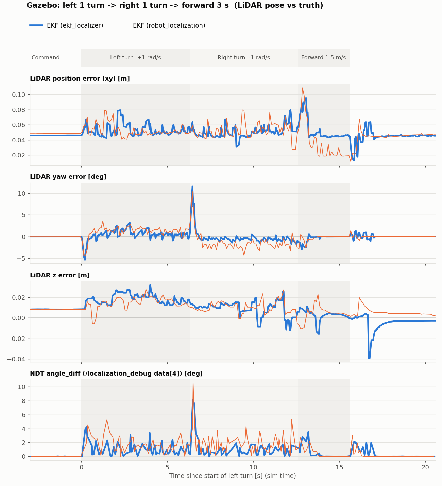

### 3. robot_localization の調整

- 原因：robot_localization は指定時刻の TF が無いと黙って最新の TF を使う（`lookupTransformSafe`）。回転中に yaw がずれる。
- やったこと：odom 側 200 Hz、map 側 `transform_timeout` 0.05 s、`vyaw` のプロセスノイズ 1.0。
- 結果：回転中の yaw 誤差 1.90 → 1.09°（ekf_localizer 1.05°）、angle_diff 平均 1.44 → 1.03°、切り替え時の angle_diff 10.0 → 4.3°。

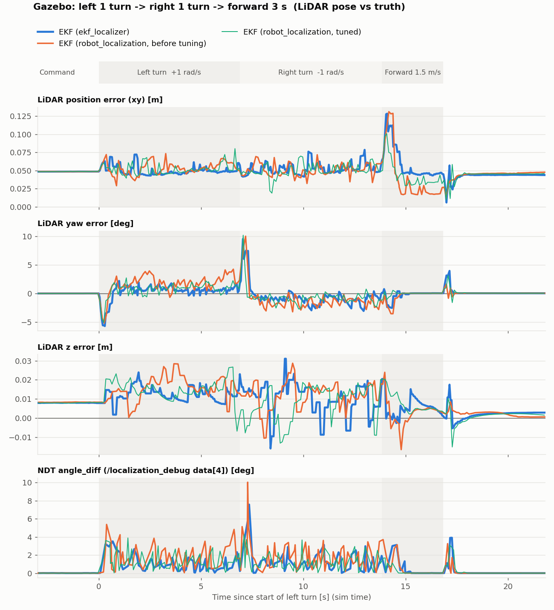

### 4. NDT 単体との比較・処理時間

- 結果：NDT 単体は yaw の誤差が小さく切り替えでも跳ねないが、点群から平均 50 ms（最大 165 ms）遅れて 10 Hz で届き、
  止まっていても y が ±3 cm ばたつく。NDT の位置合わせは動いている間 35〜41 ms。

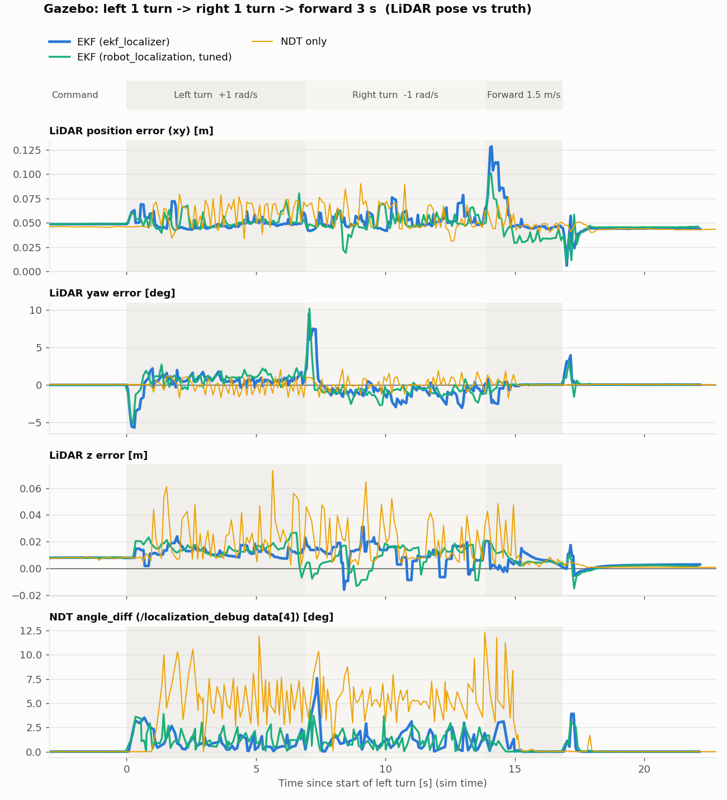

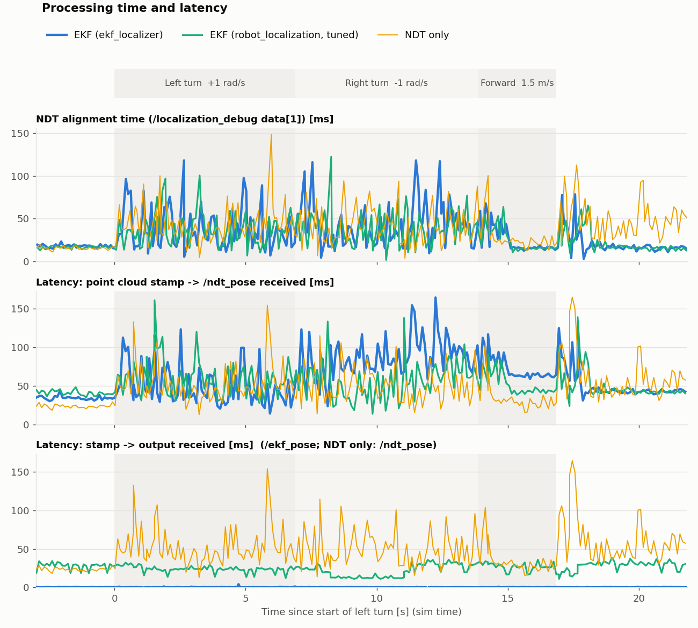

### 5. オドメトリの R を時変に（速さ・加速度に応じて）

- 結果：ばらつき（±0.04）を超える改善なし。ω に応じて R を大きくすると ekf_localizer は悪化。ROS 2 の標準に同じ機能はない。

### 6. オドメトリの遅れの補正（`odom_delay` 0.09 s）と Q

- 結果：速度が変わる 4 つの瞬間の yaw 誤差の最大の平均が ekf_localizer 4.3 → 3.3°、robot_localization 3.6 → 2.5〜3.1°
  （NDT 単体 1.7°）。→ 2026-10-12 にやめた（9.）。

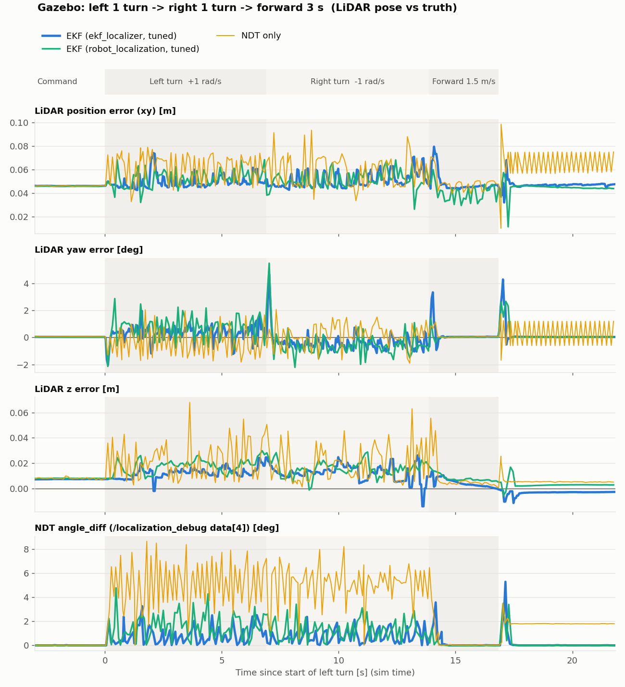

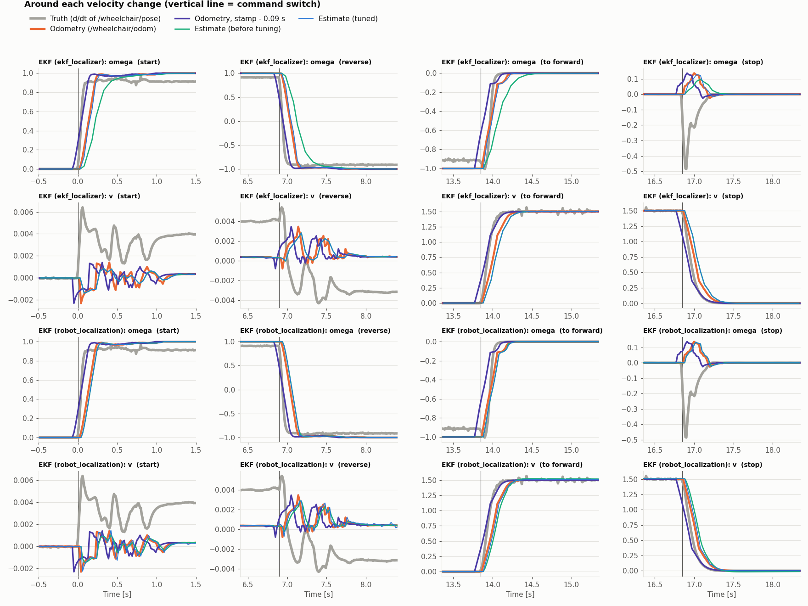

### 7. 車輪からオドメトリへの変換と omega の倍率

- 結果：diff_drive_controller の式と値は正しい。車輪が滑り、実効的な車輪間隔が 0.532〜0.535 m（設定 0.492 m）なので
  omega が約 8.5 % 大きい。Gazebo の `wheel_separation_multiplier` 1.085 で一致を確認して戻し、推定側の `odom_scale` 0.922 で補正。
  定常の回転中の yaw 誤差 ekf_localizer 0.57 → 0.18°、robot_localization 0.83 → 0.50°。

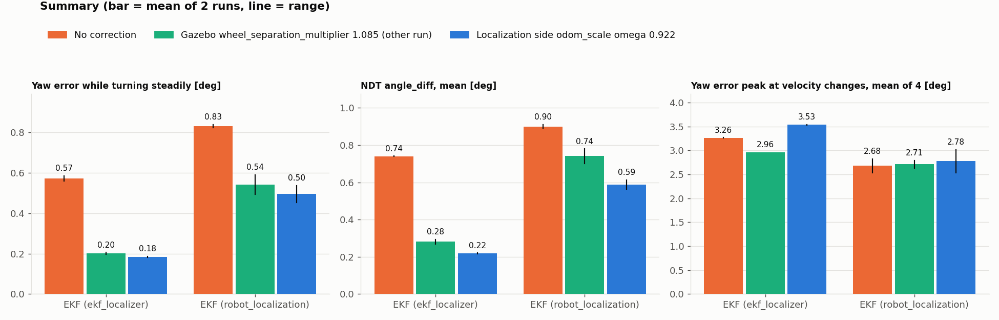

### 8. 通信をローカルに限定

- Gazebo の `.bashrc` で Gazebo 自体の通信を 127.0.0.1 に（`gazebo_changes.md`）。ROS 2 は以前から localhost のみ。

---

## 2026-10-12

### 9. 遅れの補正をやめ、車輪の角速度からオドメトリ

- 理由（ユーザーの指摘）：0.09 s 戻したオドメトリは動き出しが真値より早すぎる。
- 原因：diff_drive_controller のオドメトリは 0.2 s の移動平均で、段差が 0.2 s の直線になる（真値 60〜70 ms、オドメトリ 160 ms）。
- やったこと：`joint_state_odometry.py`（`/wheelchair/joint_states` の車輪の角速度から v・omega。未 commit）。
- 結果：反転の yaw の跳ね ekf_localizer 5.2 → 1.25°。回転→前進は悪化。

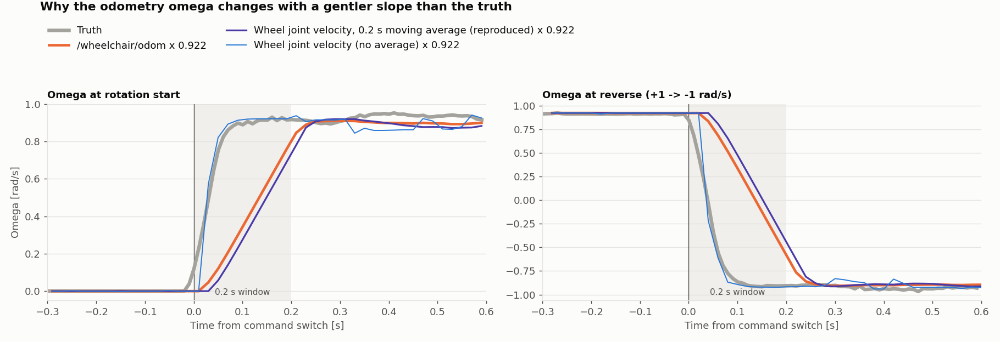

### 10. Gazebo の移動平均を 1 に（ユーザー許可）

- やったこと：Gazebo の `controller.yaml` に `velocity_rolling_window_size: 1`（0.2 s → 0.02 s。`gazebo_changes.md`）。
- 結果：omega の遅れ +98 → +2〜3 ms、立ち上がり 160 → 40 ms（真値 60〜70 ms）、ばらつき 0.010 → 0.014 rad/s（真値 0.014）。
  倍率は変わらない（0.923）。v は車輪の滑りで真値より約 60 ms 早く変わる（移動平均で隠れていた）。

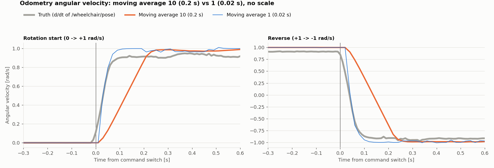

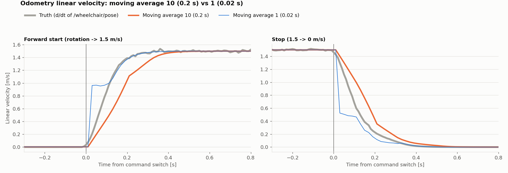

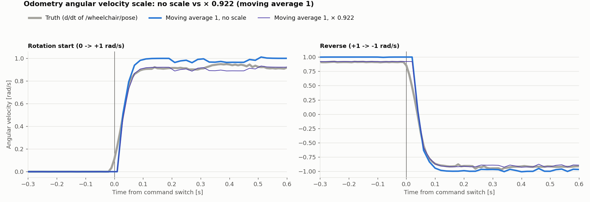

### 11. ekf_localizer：移動平均 10 → 1 の比較

- 方法：同じ録画（`spin360_w1_ekf`）を再生し、オドメトリだけを変える。変更前（移動平均 10）は同じ走行の車輪の回転角から
  作り直した入力（`localization_tools/eval/make_window_bag.py`。作り方は実物と RMS 0 で一致）。パラメータは同じ（`odom_scale` 0.922、`odom_delay` 0、Q・R）。
  各 2 回（NDT 単体は 1 回）。
- 結果（yaw 誤差 [deg]、2 回の平均）：

  | | 回転開始 | 反転 | 回転→前進 | 停止 | 定常の回転中 | angle_diff 平均 |
  |---|---|---|---|---|---|---|
  | 移動平均 10（変更前） | 5.02 | 10.20 | 1.54 | 4.10 | 0.17 | 0.25 |
  | 車輪の角速度（joint_states） | 1.34 | 1.32 | 3.14 | 5.77 | 0.21 | 0.23 |
  | **移動平均 1（変更後）** | **0.69** | **1.69** | 3.95 | 4.91 | 0.18 | 0.18 |
  | NDT 単体（参考） | 1.70 | 1.78 | 1.95 | 1.20 | 0.71 | 3.91 |

- 回転開始・反転の跳ねは NDT 単体より小さくなった（推定の omega が真値と同じ時刻に変わる）。
- 回転→前進・停止は悪化：オドメトリの omega が車体と違う動きをするため。回転→前進では車輪が先に回転をやめ
  （|omega| が半分になるのが真値より 90 ms 早い）、停止では車体がブレーキで向きを変える（0.5 s で真値 −4.35°）のに
  オドメトリは逆向き（+1.43°）。移動平均 10 はこれをならして偶然ごまかしていた。Q・R はまだ調整していない。

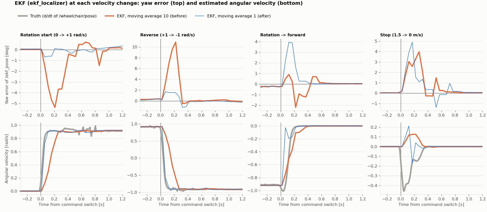

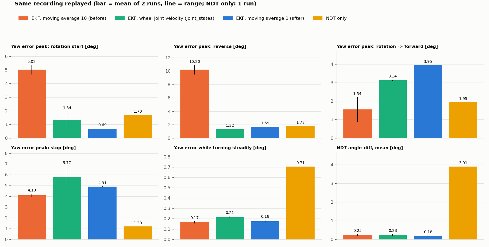

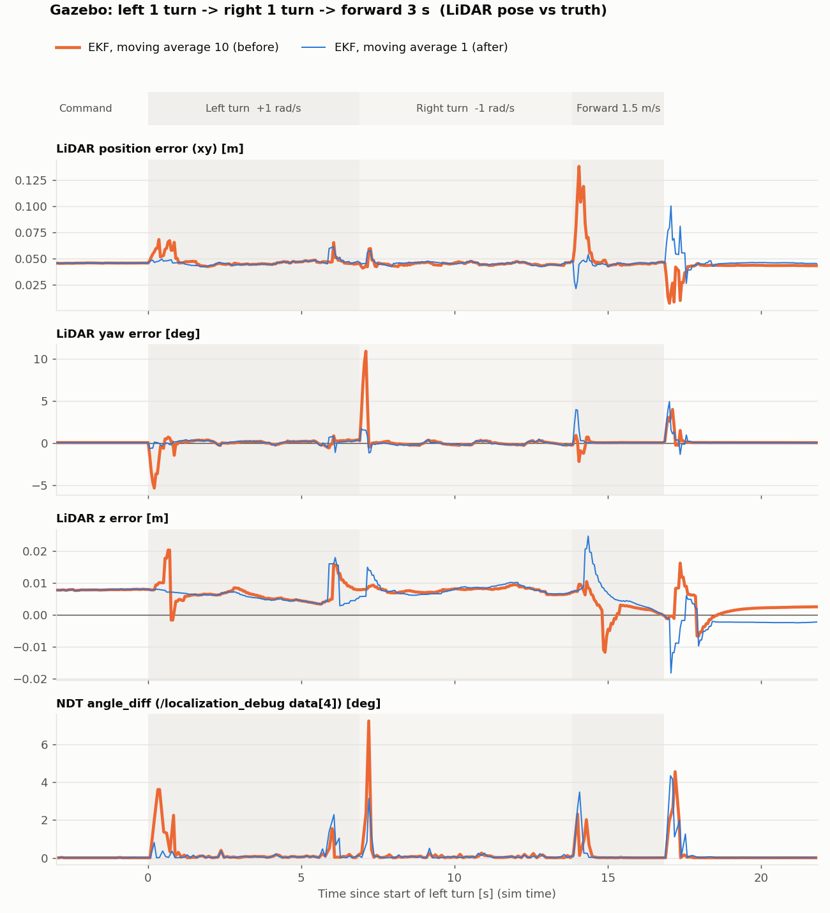

### 12. プログラムの整理・実運用のオドメトリ

- `tools/` を `localization_tools/`（git で管理）にまとめ、用途ごとに `noise/`（R を決める）・`eval/`（再生・評価・調整）・
  `plot/`（図）・`gazebo/`（走行）・`test/` に分けた。実行は `localizer_rl` の `/root/localization_tools`（`sync.sh` で写す）。
- 実運用の Gazebo のオドメトリは `/wheelchair/odom`（移動平均 1）に戻した（`gazebo.yaml`）。`joint_state_odometry` は
  環境ファイルに書いたときだけ起動する任意の機能として残す。

### 13. 観測ノイズ R を真値なしで求める

- 目的：R を実際の観測値の共分散から、実機と同じく真値なしで決める。
- 方法（`localization_tools/noise/estimate_noise.py`）：指令が一定の区間（変化の 0.5 s 後から次の変化の 0.1 s 前まで）で、
  各観測から前後 0.5 s の局所 1 次式（滑らかな真の動き）を除いた残差の分散を R とする（当てはめの自由度は補正）。
  NDT は取付で車体の姿勢に直してから当てはめ、LiDAR の姿勢に戻した値との差（map 座標）。動いている区間（旋回・直進）の値を使う。
- 結果（調整用の録画 `spin360_w1_ekf`。標準偏差）：

  | | オドメトリ v | オドメトリ omega | NDT x | NDT y | NDT z | NDT roll | NDT pitch | NDT yaw |
  |---|---|---|---|---|---|---|---|---|
  | 真値なし（R に使う） | 0.0016 m/s | 0.0098 rad/s | 4.0 mm | 8.2 mm | 4.9 mm | 0.039° | 0.039° | 0.23° |
  | 真値との差（検算） | 0.0029 | 0.019 | 3.8 | 7.6 | 5.2 | 0.12 | 0.12 | 0.20 |
  | 確認用の録画（真値なし） | 0.0018 | 0.0100 | 3.5 | 6.2 | 3.1 | 0.042 | 0.034 | 0.23 |

  今までの R（σ）：オドメトリ v 0.05 m/s・omega 0.07 rad/s、NDT x・y・z 100 mm、roll・pitch 9.9°、yaw 1.8°。
- NDT の x, y, z, yaw は真値との差とよく合う。roll・pitch は真値なしの方が小さい（向きによってゆっくり変わる誤差は
  局所 1 次式に吸収されるため）。オドメトリの真値との差には、真値（姿勢の微分）自体のばらつきも入る。
  2 本の録画でほぼ同じ値になった。
- 時間的なつながりの補正（R_eff = 分散 x 積分相関時間 tau_int。tau_int も残差の自己相関から真値なしで求める）：
  tau_int はオドメトリ omega 11、NDT roll・pitch 6〜7、x・y・yaw 1.4、v・z 1。roll・pitch の標準偏差は 0.10°
  （真値との差 0.12° に近づく）、オドメトリ omega は 0.033 rad/s。2 本の録画で同じ値。

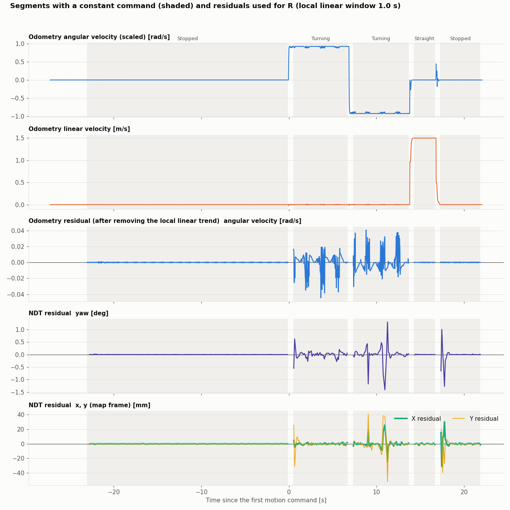

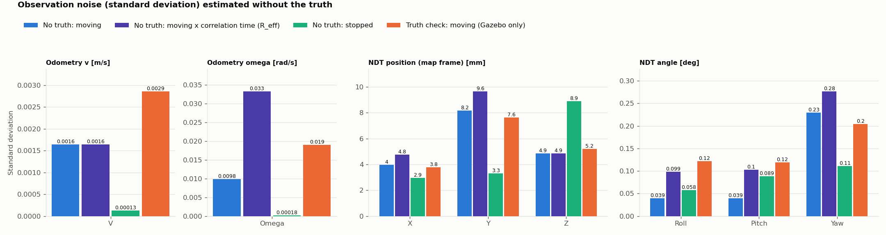

### 14. Q の調整（ekf_localizer）

- 方法：調整用の録画（`spin360_w1_ekf`）を再生して Q の候補を比べ、良いものを繰り返し、調整に使っていない録画
  （`spin360_w1_ekf2`）で確かめる。スコアは今の設定との比（速度が変わる瞬間の跳ね・定常の回転中の yaw 誤差・
  angle_diff・xy 誤差の平均。小さいほど良い。同じ設定でも ±0.05 程度ばらつく）。結果は `eval/results/results_qr*.jsonl`、
  まとめは `eval/aggregate.py`。
- 結果：
  - 新しい R で Q を今のまま：スコア 3.3（大きく悪化）。R が 60〜600 倍小さくなり、NDT を強く信じすぎる。
  - Q を下げると今の設定と同じくらいになる。安定していたのは x・y 5e-3、z 5e-4、roll・pitch 5e-3、yaw 5e-4
    （v 0.05・omega 10 は今のまま）で、調整用の録画で 0.98〜1.08（今の設定 0.98〜1.02）。
  - 調整に使っていない録画では、今の設定 1.00（0.94〜1.11）に対して 1.47（1.35〜1.71）。定常の回転中の yaw 誤差
    0.19 → 0.30°、angle_diff 0.20 → 0.45°。速度が変わる瞬間の跳ねは同じ。
  - 時間的なつながりを補正した R_eff でも、同じ設定で 1.03 と 2.95 のように流すたびに大きく変わる。
- 原因：R が小さいと、EKF が遅れて届く NDT の解に飛びつき、それが次の NDT の初期値になるので、NDT と EKF の間で
  振動が起きることがある（下の図。同じ設定の 2 回の再生で、2 回目は左回転中に yaw が ±2° で振動し angle_diff が約 2.5°）。
  今の大きな R ではオドメトリの予測を主に使うので、この循環が弱い。測った R（NDT のばらつき）は、
  循環がうまく働いているときの値。
- 結論：`gazebo.yaml` の R・Q は今のまま（変えていない）。

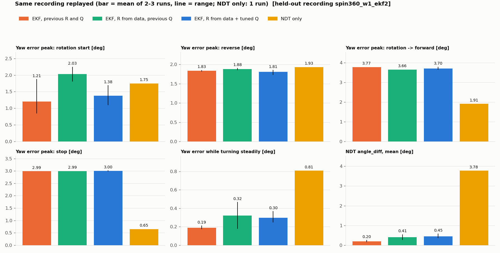

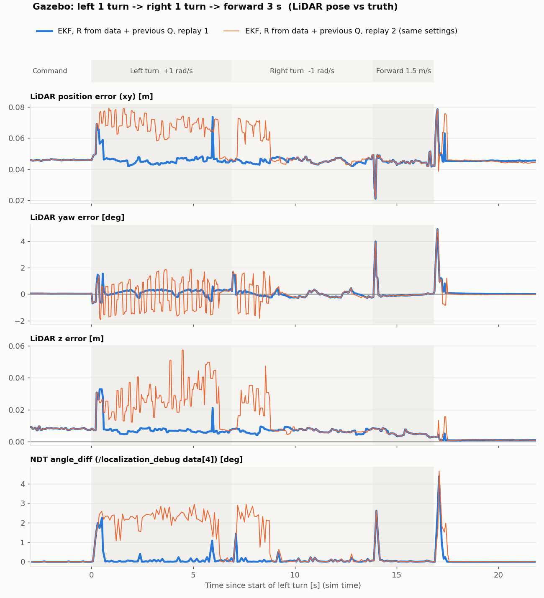

### 15. NDT の R を「真値 + ノイズ」の初期値で求める

- 目的：EKF との循環（EKF の推定が NDT の初期値になる）から切り離して、NDT そのものの誤差を測る（ユーザー指示）。
- 方法（`localization_tools/noise/ndt_init_noise.py`）：
  - `gazebo/drive_stops.py` で 13 か所に 5 s ずつ止まる走行を録る（`stops_ekf`。初期位置で 45° ずつ 8 方向、1.5 m 先で 90° ずつ 5 回）。
  - 真値は止まった区間（始めの 1 s を除く）の `/wheelchair/pose` の平均。
  - NDT だけを起動して点群を流し直す。初期値は「真値 + 正規分布のノイズ」。ノイズの標準偏差は運用中の EKF の誤差
    （動いている間の rms：xy 4〜6 mm、z 2〜6 mm、yaw 0.5°。最大 50 mm・27 mm・4.9°）の 2〜4 倍で、
    x・y 20 mm、z 10 mm、roll・pitch 0.3°、yaw 1°。
  - ノイズなし 1 回、ノイズあり 3 回（各 530 スキャン）。止まった区間ごとの平均を引いた誤差の分散を R_ndt とする。
- 結果（NDT の誤差の標準偏差）：

  | | x | y | z | roll | pitch | yaw |
  |---|---|---|---|---|---|---|
  | 初期値 = 真値 | 0.3 mm | 0.3 mm | 0.3 mm | 0.003° | 0.003° | 0.03° |
  | 初期値 = 真値 + ノイズ（R_ndt） | 14 mm | 28 mm | 21 mm | 0.20° | 0.18° | 0.74° |
  | 今の R | 100 mm | 100 mm | 100 mm | 9.9° | 9.9° | 1.8° |

  - 初期値が真値なら NDT の解はほとんどばらつかない。ずれた初期値からは、真値の近くの別の解（局所解）に収束する。
    yaw は +1° と −1.2°、y は ±40 mm に解が集まる（初期値の yaw が 0.5° 以上ずれると、ずれと逆の側の解になることが多い）。
    R が小さいときの EKF の振動（14.）はこれで説明できる（NDT が逆の側の解を出し、それが次の初期値になる）。
  - 地図と Gazebo の座標の一定のずれは、どの停止位置でも x +41 mm、y −21 mm。
- EKF で確かめる（調整に使っていない録画 `spin360_w1_ekf2` の再生、Q とオドメトリの R は今のまま）：
  この R_ndt でスコア 1.04（1.02〜1.06、今の設定 1.00（0.94〜1.11））、定常の回転中の yaw 0.23°（今 0.19°）、
  angle_diff 0.20°（同じ）。オドメトリの R も R_eff（13.）にすると 1.26 に悪化。
  **（訂正）2 回だけの結果で、回数を増やすと悪い状態に入ることが多かった（17.）。**

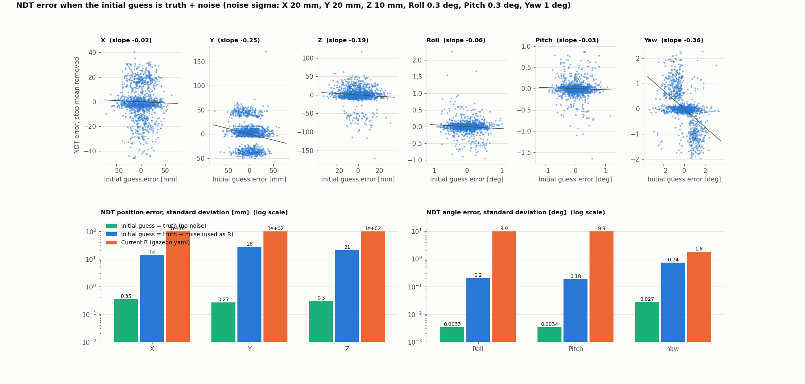

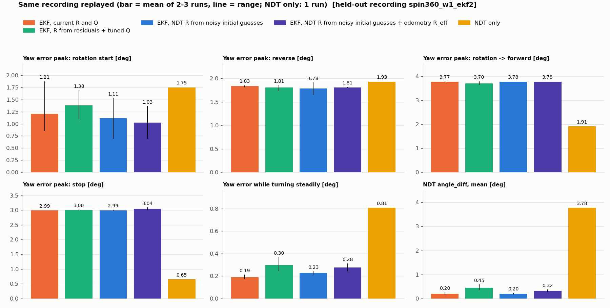

### 16. LiDAR の取付位置とオドメトリの倍率の推定

- 目的：実機でも使えるように、真値なしで取付位置と倍率を求める。
- 方法（`localization_tools/calib/estimate_calibration.py`）：NDT の LiDAR の姿勢と、倍率を掛ける前のオドメトリから求める。
  - omega の倍率：その場の旋回の区間の NDT の yaw の変化 / オドメトリの omega の積分
  - v の倍率：直進の区間の移動距離 / v の積分
  - 取付の x, y：旋回中は LiDAR が回転の中心のまわりを回るので、円を最小二乗で当てはめる
  - 取付の yaw：直進の向きと LiDAR の yaw の差
  - roll・pitch：止まっている間の NDT（床が水平と仮定）。z：地図の床の高さとの差（参考）
- 結果（`spin360_w1_ekf`・`spin360_w1_ekf2`・`stops_ekf`、旋回 16 区間・直進 3 区間）：

  | | 推定（真値なし） | 今の設定（Gazebo の URDF） |
  |---|---|---|
  | omega の倍率 | 0.9244 | 0.922（区間ごとの真値の比 0.913〜0.938） |
  | v の倍率 | 0.9998 | 1.0 |
  | 取付 x, y | −171.3 mm、−3.7 mm（±0.4 mm） | −170 mm、0 mm |
  | 取付 yaw・roll・pitch | +0.02°、−0.05°、+0.02° | 0、0、0 |
  | 取付 z（参考） | 1.175 m | 1.138 m（地図の床が 3.7 cm 低く出る） |

  omega の倍率は 0.5 rad/s の短い旋回（45°・90°）で 0.913〜0.939 とばらつき、1 rad/s の 1 周では 0.922〜0.925。

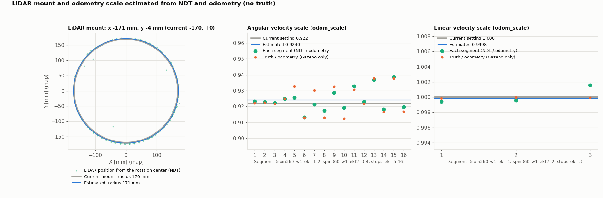

### 17. R_ndt を gazebo.yaml に入れて確かめる

- やったこと：15. の R_ndt を `gazebo.yaml` の `ekf_localizer` と `robot_localization_adapter` に入れ（ユーザー指示）、
  調整に使っていない録画（`spin360_w1_ekf2`）を `gazebo.yaml` のまま再生した。
- 結果（スコアは今の設定の ekf_localizer との比）：

  | | 回数 | スコア | 定常の回転中の yaw | angle_diff 平均 |
  |---|---|---|---|---|
  | ekf_localizer、今までの R_ndt | 5 | 0.94〜1.11 | 0.20° | 0.21° |
  | ekf_localizer、新しい R_ndt | 8 | 1.02〜2.46（6 回が 1.6 以上） | 0.46°（0.22〜0.70） | 0.51° |
  | robot_localization、今までの R_ndt | 2 | 2.07〜2.23 | 0.53° | 0.74° |
  | robot_localization、新しい R_ndt | 2 | 1.89〜2.08（今までとの比 0.86〜0.96） | 0.49° | 0.60° |

- ekf_localizer は、新しい R_ndt だと NDT と EKF の振動（14.・15.）に入ることが多い。15. の 2 回はたまたま入らなかった。
  設定は 15. と同じ（違いは ekf_localizer では起動しない adapter の区間だけ）。robot_localization は少し良くなった。
- 決めたこと（ユーザー判断）：新しい R_ndt は robot_localization（`robot_localization_adapter`）だけに入れ、ekf_localizer は今までの値（`ekf.yaml`）のまま。commit・push 済み。
- **訂正（2026-10-12、22. で判明）**：robot_localization の 2 行は、どちらも同じ R_ndt（`robot_localization.yaml` の値）で動いていた。
  launch が env の上書きを `/**` の節で渡していたため、`robot_localization.yaml` のノード名の節（`robot_localization_adapter:`）が
  優先され、adapter の R_ndt は変わっていなかった（`ros2 param get` で確認）。「少し良くなった（0.86〜0.96）」は再生ごとのばらつき。
  2026-10-11 の robot_localization の調整（`batch1`〜`3`）の R_ndt の候補も同じ理由で効いていなかった。launch は 22. で直した。

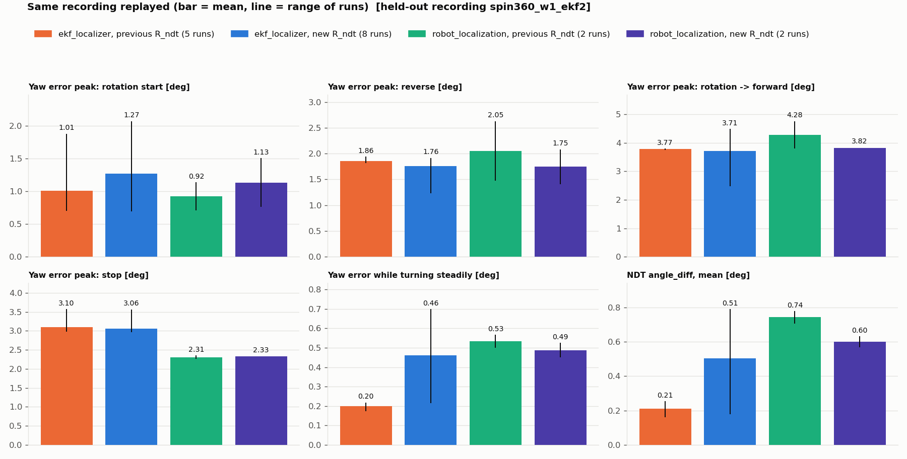

### 18. ekf_localizer の予測を水平面の中点法（RK2）にする

- やったこと（ユーザー指示。`ekf_localizer` の humble を直接変更）：`src/ekf_core.cpp` の予測（`propagate`）とヤコビアン。
  - これまで：円弧の厳密積分（sinc の補正）。水平の速さ v cos(pitch)、z は −v sin(pitch) で動かす。
  - 今回：水平面を移動すると仮定し、x, y, yaw を中点法で積分する（yaw_m = yaw + omega dt / 2、x += v dt cos(yaw_m)、
    y += v dt sin(yaw_m)、yaw += omega dt）。roll, pitch による v, omega の分解はしない。z, roll, pitch は予測では動かさず Q のノイズだけ。
  - テストを直した（中点法の式、水平面の仮定、円弧の厳密解との差 v dt (1 − sinc(omega dt / 2))、坂で NDT が途切れても z が動かない）。
    30 本すべて通る。
- 結果（今の `gazebo.yaml` のまま、同じ録画の再生。スコアは前の式との比）：

  | | 確認用の録画 | 調整用の録画 | 動いている間の z 誤差の標準偏差（確認用 / 調整用） |
  |---|---|---|---|
  | 前の式 | 1.00（0.94〜1.11、3 回）・1.06（2 回） | 1.00（0.98〜1.02、2 回） | 4.1 / 4.1 mm |
  | 中点法 | 0.99（0.92〜1.10、4 回） | 0.95（0.94〜0.96、2 回） | 3.2 / 3.1 mm |

  - yaw・xy・angle_diff は同じ（Gazebo の床は水平なので cos(pitch) は 1 に近く、厳密な円弧との差は dt 0.05 s で 1e-4 程度）。
  - z は NDT の pitch のばらつきが予測に入らなくなった分だけ落ち着いた（最大のずれも 19 → 14 mm、28 → 22 mm）。
    前の式は停止のブレーキで車体が傾いた分を z の予測に入れていた（下の図の 17 s 付近）。
- ekf_localizer の commit（b2360c0）は 19. のあと GitHub の humble に push した。

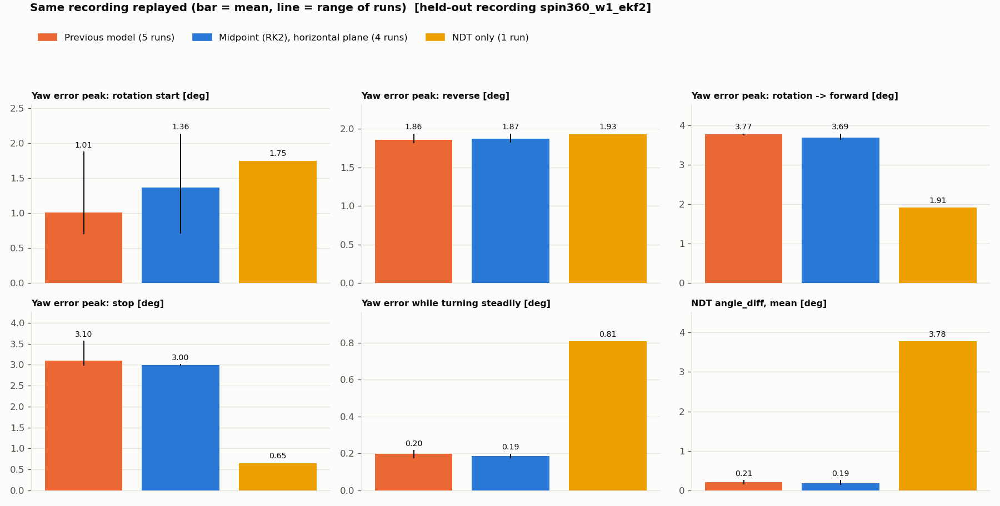

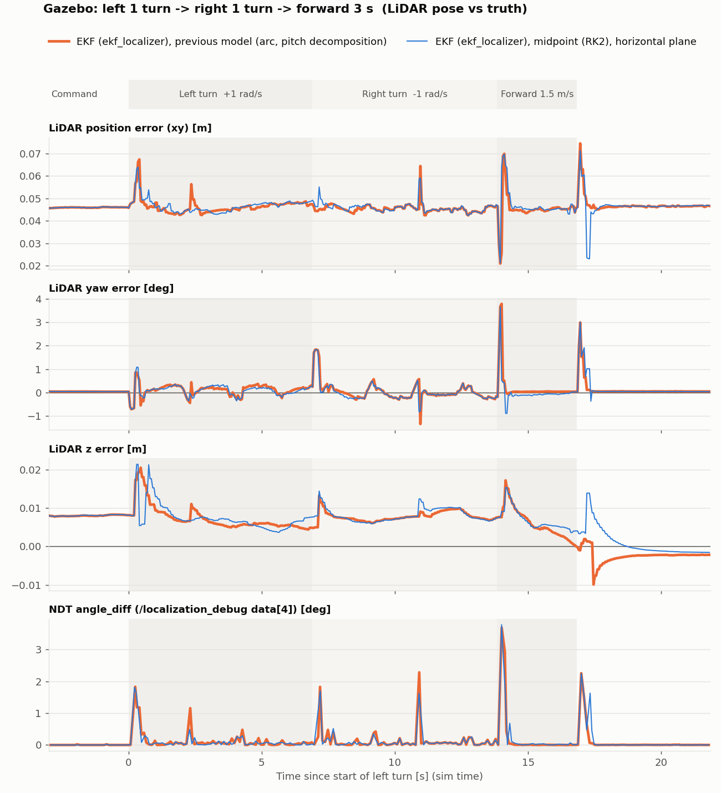

### 19. ekf_localizer の NDT の観測を車両（base）の姿勢にする

- やったこと（ユーザー指示。humble を直接変更、6 成分を 1 回で更新する形をユーザーが選択）：
  - NDT の LiDAR の姿勢 z_L を取付で base の姿勢 z_B = T_L · T_BL⁻¹ に直して観測にする（h(x) は状態の先頭 6 成分、H = [I 0]）。
  - 観測ノイズは LiDAR の `R_ndt`（対角）を z_L → z_B のヤコビアンで伝播した J R_ndt Jᵀ（相関込みの 6×6。robot_localization の
    adapter と同じ）。LiDAR は base の 1.1 m 上にあるので、今の R_ndt（roll・pitch の σ 9.9°）では base の x, y の σ が約 22 cm、
    roll・pitch との相関が約 0.9 になる。
  - 4 段の更新（x/y/yaw・z・roll・pitch）とロックアウトをやめ、ゲートは 6 成分の `gate_ndt` 1 つ（既定 16.81 = χ²(6) の 99%。
    `ekf.yaml` は 1.0e5 で今までと同じく実質無効）。
  - テスト（31 本すべて通る）：base への変換が厳密、共分散の伝播が 20 万個の標本と一致、LiDAR の姿勢のまま更新したときとの差が
    更新量の 0.2 %（1 次で同じ）、1 成分が飛ぶと観測全体を棄却。
- 結果（今の `gazebo.yaml` のまま、同じ録画の再生。スコアは前の式との比）：

  | | 確認用の録画 | 調整用の録画 | z 誤差の標準偏差（確認用 / 調整用） |
  |---|---|---|---|
  | 前の式・LiDAR の姿勢で観測 | 1.00（3 回） | 1.00（2 回） | 4.1 / 4.1 mm |
  | 中点法・LiDAR の姿勢で観測（18.） | 0.99（0.92〜1.10、4 回） | 0.95（2 回） | 3.2 / 3.1 mm |
  | 中点法・base の姿勢で観測 | 1.02（0.95〜1.19、4 回） | 0.96（0.92〜0.99、2 回） | 3.4 / 2.5 mm |

  相関込みの共分散で 1 回で更新しているので、LiDAR の姿勢で観測していたときと同じ情報になり、結果も同じ程度。
- ekf_localizer の commit（b2360c0、be6fce8）は GitHub の humble に push した（ユーザー確認済み）。

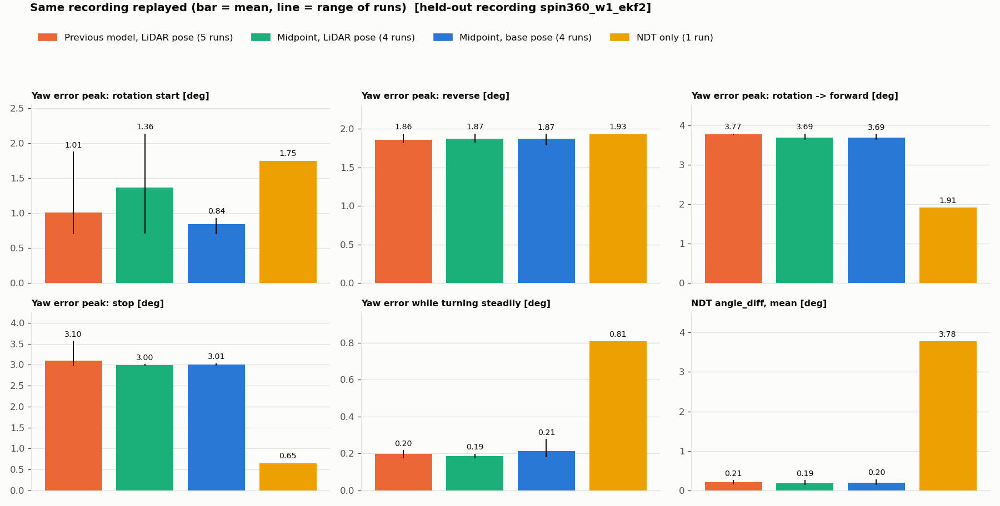

### 20. NDT のノードに入っていたころの EKF の動かし方を復活させる

- 当時（lidar_localization の fae635e）の EKF は、計算（予測・観測モデル）は今日の変更前の ekf_localizer とほぼ同じで、
  違いは動かし方：NDT と同じノードの中で、点群を受信した時刻（`time_source: wall`）を観測の時刻にし、届いた順に処理（巻き戻しなし）、
  更新のたびに事後推定値を配信、ゲート有効、Q・P_init が違う。
- やったこと（ユーザー指示：別のノードのまま、「受信時刻で届いた順に処理」と「更新のたびに事後推定値を配信」を復活。中点法・base の姿勢の観測は今のまま）：
  ekf_localizer に `time_source`（`stamp` 既定 / `receipt`）と `publish_trigger: update` を追加（既定の動きは変えない。commit 0fb1488、21. のあと push）。
- 結果（調整に使っていない録画 `spin360_w1_ekf2`、各 4 回。スコアは前の式との比）：

  | | スコア | 定常の回転中の yaw | angle_diff 平均 |
  |---|---|---|---|
  | 今（stamp + timer） | 1.02（0.95〜1.19） | 0.21° | 0.20° |
  | stamp + update | 0.94（0.91〜0.95） | 0.19° | 0.16° |
  | 当時の動かし方（receipt + update） | 6.9（6.6〜7.5） | 2.6° | 2.1° |

  - receipt では、`/ndt_pose` が点群の時刻から平均 56〜67 ms（最大約 0.8 s）遅れて届くので、その分遅れた時刻の観測になり、
    回転中（0.92 rad/s）に yaw が約 3° 回転と同じ向きに遅れる。当時は同じノードの中で、点群を受信した時刻（位置合わせの前）を使って
    いたのでこの遅れは無かった。別のノードではこの時刻が分からない。
  - update（更新のたびに事後推定値を配信）は、時刻を stamp にすると今より少し良く、ばらつきも小さい
    （オドメトリの時刻ごとに TF が出るので、NDT が点群の時刻で引く初期値が正確になると考えられる）。

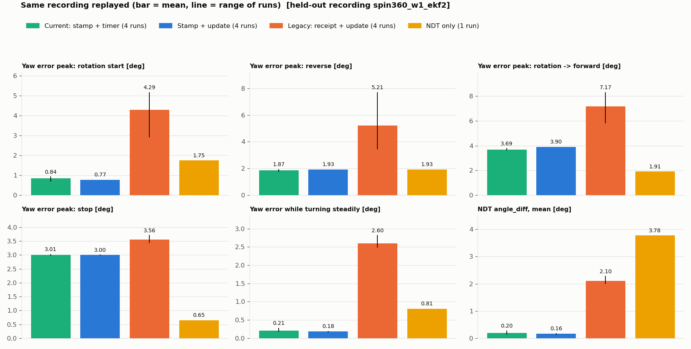

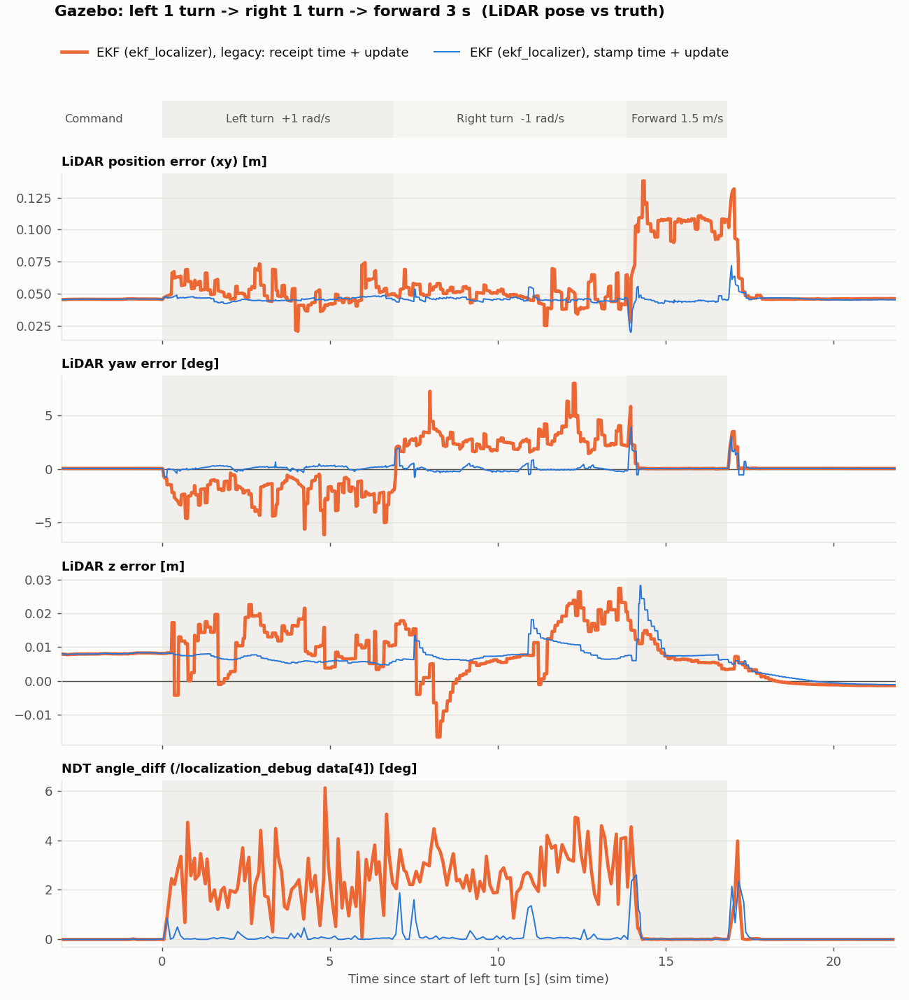

### 21. receipt の NDT を点群の受信時刻にする、Gazebo を publish_trigger: update にする

- やったこと（ユーザー指示）：
  - `time_source: receipt` の NDT の観測の時刻を、その点群（`points_topic`）を受信した時刻にした（ekf_localizer が点群も受け取り、
    stamp ごとに受信時刻を覚える。NDT は計算の分遅れて届くので、点群の時刻まで巻き戻して入れる。commit 2739d6d。0fb1488 とともに GitHub の humble に push 済み）。
  - Gazebo（`gazebo.yaml`）の ekf_localizer を `publish_trigger: update` にした（時刻は stamp のまま。localization_bringup に push）。
- 結果（調整に使っていない録画）：

  | | 回数 | スコア | 定常の回転中の yaw |
  |---|---|---|---|
  | stamp + timer（変更前） | 4 | 1.02（0.95〜1.19） | 0.21° |
  | stamp + update（今の Gazebo） | 6 | 0.96（0.91〜1.02） | 0.19° |
  | receipt（NDT は点群の受信時刻）+ update | 4 | 1.03（0.99〜1.12） | 0.21° |
  | receipt（NDT は /ndt_pose の受信時刻）+ update（20.） | 4 | 6.9 | 2.6° |

  - 点群の受信時刻にすると、NDT の計算の遅れによる悪化がなくなり、stamp と同じ程度になる（Gazebo では点群の受信は stamp とほぼ同時）。
  - stamp + update は、同じ設定でも前回の 4 回（0.91〜0.95）と今回の 2 回（1.00〜1.02）で少し違う。6 回で見ると timer と同じか少し良く、
    ばらつきが小さい。

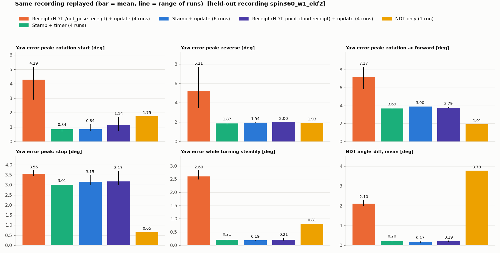

### 22. ekf_localizer と robot_localization を様々な動きで比べる

- 目的：今の設定でどちらの推定器が優れているかを、いろいろな動きで確かめる（ユーザー指示）。
- やったこと：
  - Gazebo で 4 つの動きを録画した（`gazebo/drive_profile.py`）。既存の 2 つと合わせて 6 つ：
    - 加減速：0.5 → 1.0 → 1.5 m/s、急停止、急発進。約 16 m
    - 曲線：半径 1 m の 8 の字を v, omega 0.4 と 0.8 で。部屋に収まるよう、選択肢の例の半径 2 m から縮めた
    - スラローム：1 m/s、omega ±0.5 rad/s、周期 6 s
    - 後退：S 字に後退し、止まらずに前進・速い後退に切り替える
    - その場の回転：`spin360_w1_ekf2`
    - 13 か所で止まる走行：`stops_ekf`
  - 同じ録画を推定器ごとに 4 回ずつ再生した（`eval/compare_run.py`。ユーザー判断で「同じ録画を再生」）。誤差は 2 通りで測った（ユーザー判断で両方）：
    - `/ekf_pose` の stamp の時刻の真値との差（推定そのものの精度）
    - 実時間の誤差：100 Hz の各時刻に、その時点で受信済みの最新の `/ekf_pose` とその時刻の真値との差（MATLAB が使う値）
  - **途中で、launch が env の上書きを robot_localization の adapter に渡せていなかったことが分かった**（17. の訂正）。
    `gazebo.yaml` の adapter の R_ndt も `publish_trigger` も効いていなかった。launch を、上書きをノード名の節の一時 yaml にして
    渡すように直した（`_scoped`。`ros2 param get` で全ノードの値を確認、合成データテストも通る。commit 8e72fd5、23. で push）。
  - robot_localization は 3 つの条件で流した（ユーザー判断で 2 つ目・3 つ目を追加）：
    - 「RL」：R_ndt が ekf_localizer と同じ。launch を直す前に実際に動いていた設定
    - 「RL 小 R_ndt」：`gazebo.yaml` の R_ndt（止まった状態で測った小さい値）。launch を直して初めて効く
    - 「RL 小 R_ndt + timer」（参考）：/ekf_pose を timer（50 Hz、現在時刻まで予測）で出す
- 結果（各 4 回の平均。単位は deg・mm・ms。幅は図）：

  | 動き | 条件 | yaw 平均 | 切り替え時の yaw | z 平均 | roll/pitch 平均 | xy 最大 | 実時間 yaw 平均 | 実時間 切り替え時の yaw | 推定の古さ |
  |---|---|---|---|---|---|---|---|---|---|
  | 加減速 | ekf_localizer | 0.07 | 0.70 | 4 | 0.15 | 57 | 0.07 | 0.72 | 15 |
  | | RL | 0.07 | 0.65 | 3 | 0.14 | 62 | 0.08 | 0.76 | 73 |
  | | RL 小 R_ndt | 0.09 | 0.67 | 3 | 0.07 | 64 | 0.10 | 0.80 | 73 |
  | | RL 小 R_ndt + timer | 0.10 | 0.75 | 3 | 0.08 | 69 | 0.11 | 0.77 | 15 |
  | 曲線 | ekf_localizer | 0.13 | 0.95 | 3 | 0.10 | 73 | 0.27 | 1.34 | 15 |
  | | RL | 0.28 | 0.95 | 4 | 0.11 | 78 | 1.36 | 3.79 | 71 |
  | | RL 小 R_ndt | 0.39 | 1.00 | 5 | 0.07 | 100 | 1.40 | 3.79 | 71 |
  | | RL 小 R_ndt + timer | 0.27 | 0.97 | 4 | 0.07 | 94 | 0.39 | 1.40 | 15 |
  | スラローム | ekf_localizer | 0.10 | 0.68 | 2 | 0.11 | 82 | 0.18 | 0.76 | 15 |
  | | RL | 0.20 | 0.57 | 2 | 0.09 | 82 | 0.76 | 0.95 | 71 |
  | | RL 小 R_ndt | 0.24 | 0.73 | 3 | 0.07 | 83 | 0.81 | 1.09 | 72 |
  | | RL 小 R_ndt + timer | 0.19 | 0.84 | 3 | 0.07 | 103 | 0.23 | 0.90 | 15 |
  | 後退 | ekf_localizer | 0.13 | 1.12 | 4 | 0.11 | 73 | 0.17 | 1.26 | 15 |
  | | RL | 0.16 | 0.90 | 5 | 0.12 | 92 | 0.46 | 1.78 | 72 |
  | | RL 小 R_ndt | 0.17 | 0.93 | 4 | 0.08 | 80 | 0.47 | 1.83 | 72 |
  | | RL 小 R_ndt + timer | 0.13 | 1.09 | 4 | 0.08 | 85 | 0.16 | 1.25 | 15 |
  | その場の回転 | ekf_localizer | 0.21 | 2.40 | 7 | 0.13 | 77 | 0.61 | 3.03 | 15 |
  | | RL | 0.46 | 1.88 | 10 | 0.21 | 68 | 2.68 | 6.15 | 73 |
  | | RL 小 R_ndt | 0.87 | 2.24 | 23 | 0.20 | 91 | 2.72 | 6.42 | 73 |
  | | RL 小 R_ndt + timer | 0.77 | 2.98 | 21 | 0.19 | 90 | 0.96 | 3.55 | 15 |
  | 13 か所で止まる | ekf_localizer | 0.13 | 0.57 | 5 | 0.11 | 64 | 0.21 | 0.85 | 15 |
  | | RL | 0.18 | 0.52 | 6 | 0.11 | 63 | 0.56 | 2.70 | 74 |
  | | RL 小 R_ndt | 0.62 | 1.15 | 13 | 0.16 | 77 | 0.93 | 3.20 | 74 |
  | | RL 小 R_ndt + timer | 0.59 | 1.05 | 13 | 0.16 | 76 | 0.61 | 1.29 | 15 |

  - **今の設定どうしでは ekf_localizer のほうが良い**。
    - yaw・z の平均は全部の動きで同じか小さい（曲線 0.13 対 0.28°、回転 0.21 対 0.46°）。時間推移も滑らかで、RL は回転中・速い円で
      xy・z・pitch・yaw が点群ごとにばたつく。
    - 実時間では差がさらに大きい（回転 0.61 対 2.68°）。RL の `/ekf_pose`（cloud）は点群ごとに 10 Hz で、使える推定が平均 72 ms 古い。
      ekf_localizer（update）は 15 ms。
  - RL が良いのは、指令が変わる瞬間の yaw の跳ねだけ（回転 1.88 対 2.40°、後退 0.90 対 1.12°、スラローム 0.57 対 0.68°）。
    ekf_localizer の跳ねが大きい原因は未確認（omega の Q が 10 と大きく、滑ったオドメトリに付いていく可能性がある）。
    ただし RL（cloud）は 10 Hz の値の最大なので、短い跳ねを取り逃がしている可能性がある。23. で 50 Hz（timer）にすると、
    この差はほぼなくなった。
  - **小さい R_ndt は RL を悪くする**。roll/pitch は小さくなる（0.07〜0.08°）が、回転と停止で NDT と振動して yaw・z が大きくなる
    （回転 yaw 0.46 → 0.87°、z 10 → 23 mm。yaw が点群ごとに ±2° で交互に振れる）。15.・17. の ekf_localizer と同じ現象。
  - timer にすると RL の実時間の誤差は ekf_localizer に近づく（曲線 1.40 → 0.39°。ekf_localizer は 0.27°）。stamp の時刻の誤差は
    cloud と同程度。
  - xy の平均（表に無し）はどれも 34〜56 mm で、大部分は地図と Gazebo の座標のずれ。このずれは場所で変わり、直進 16 m で
    x +40 → 0 mm になる。止まっていても同じで、どの推定器でも出る。開始位置の近く（回転・停止）でこのずれを引くと
    ekf_localizer 3 mm、RL 12・3 mm、RL 小 R_ndt 30・21 mm。

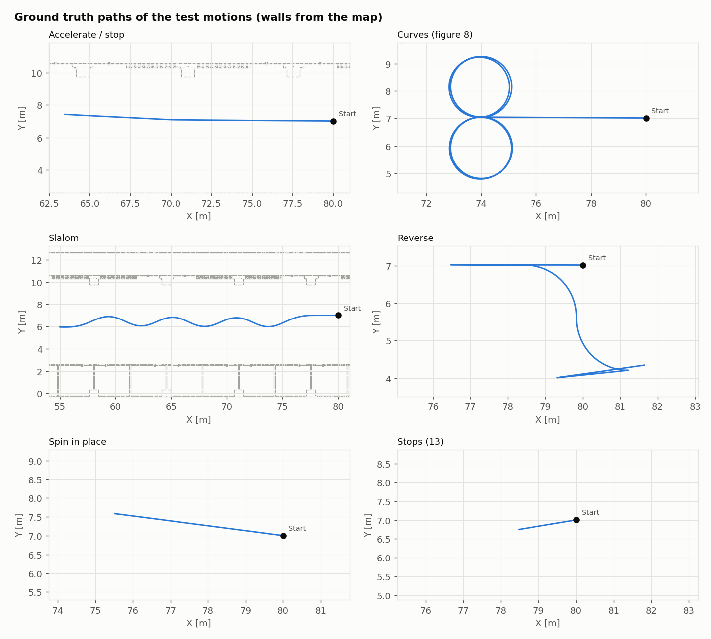

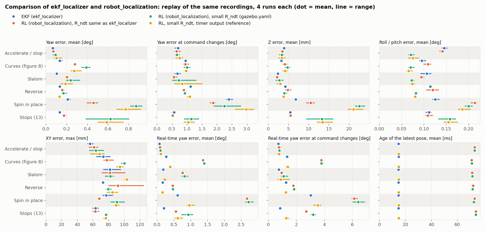

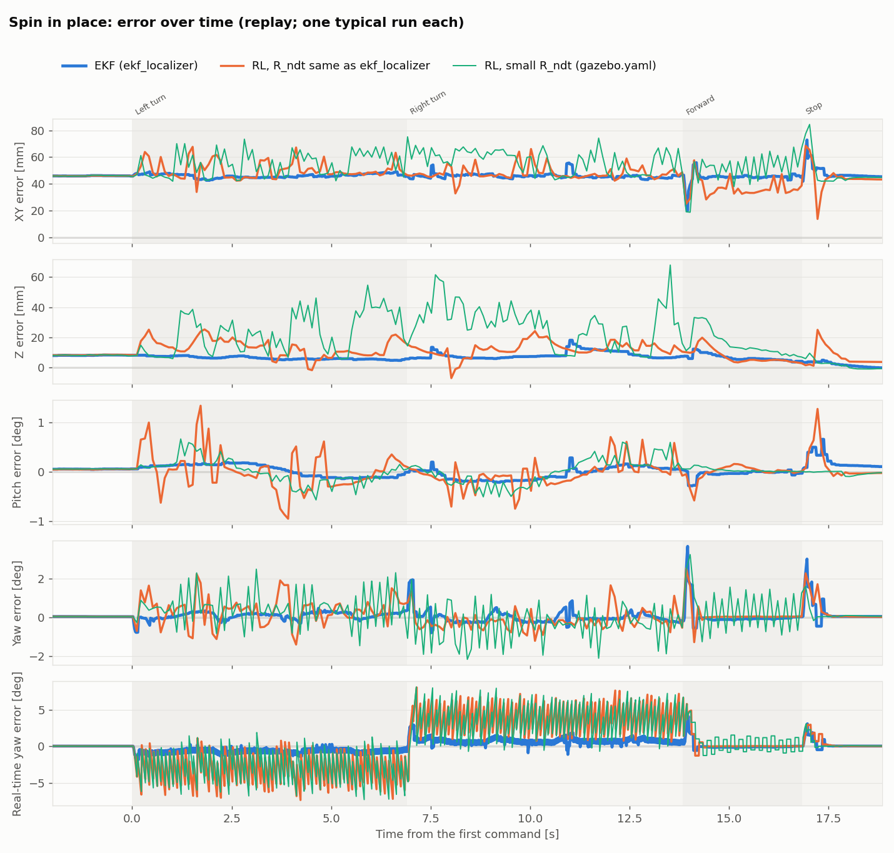

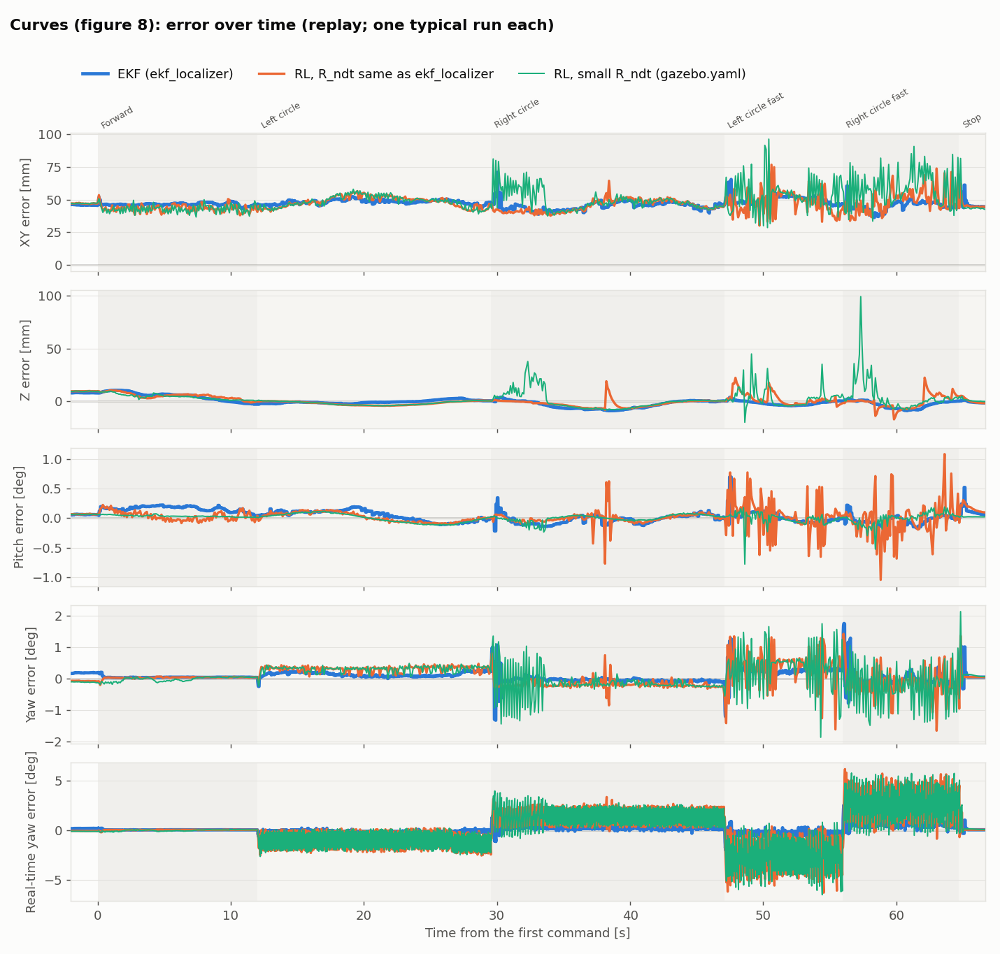

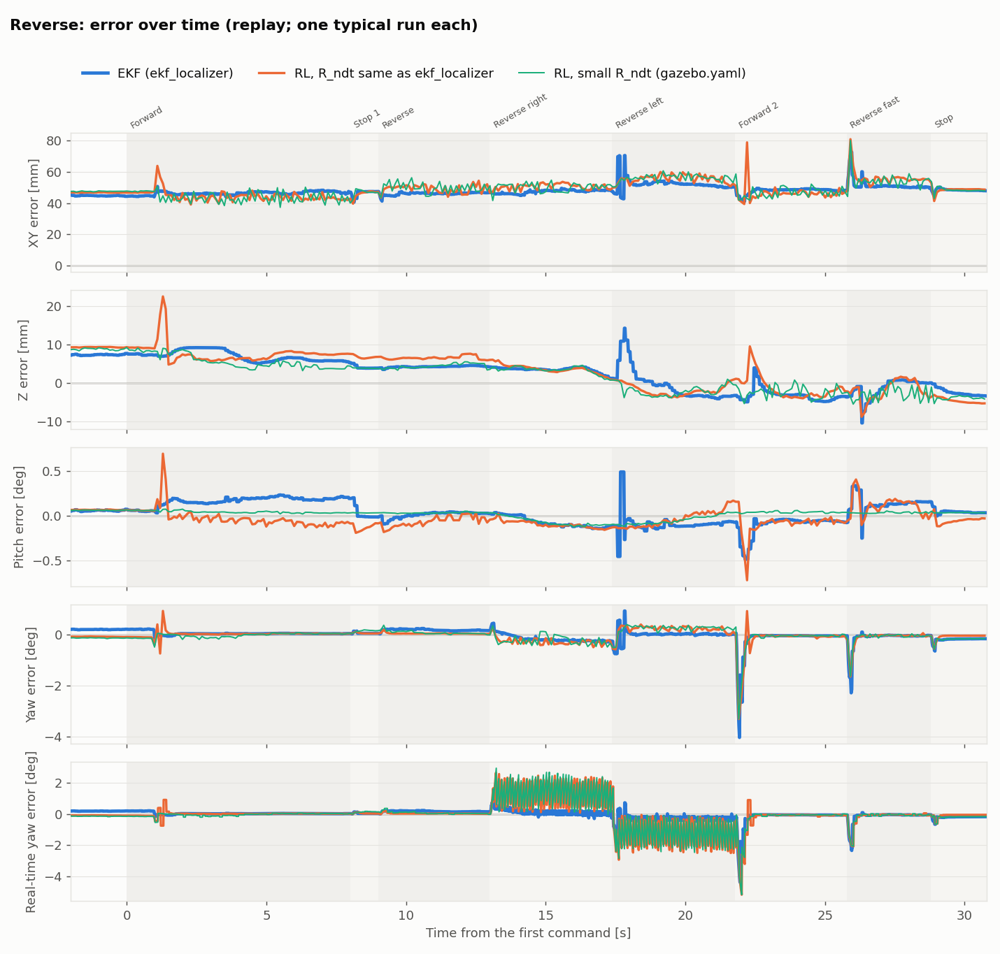

## 2026-10-13

### 23. robot_localization の設定を決め直し、確かめる

- 決めたこと（ユーザー判断、22. を受けて）：
  - launch の修正を commit・push する。
  - `gazebo.yaml` から adapter の小さい R_ndt を外す（`robot_localization.yaml` の値。ekf_localizer と同じ）。
  - adapter の `publish_trigger` の既定を `timer` にする（`robot_localization.yaml`。実機も timer になる。実機では未確認）。
  - 評価ツールが、env の空の節（`robot_localization_adapter:` にコメントだけ）で落ちたので直した。
  - localization_bringup の `robot_localization` ブランチに commit（8e72fd5：launch、793998b：設定）し、GitHub に push した。
- 確かめたこと：変えたあとの設定のまま、22. と同じ 6 つの動きを 4 回ずつ再生した（`ros2 param get` で timer・R_ndt を確認）。

  | 動き | 推定器 | yaw 平均 | 切り替え時の yaw | z 平均 | roll/pitch 平均 | xy 最大 | 実時間 yaw 平均 | 実時間 切り替え時の yaw |
  |---|---|---|---|---|---|---|---|---|
  | 加減速 | ekf_localizer | 0.07 | 0.70 | 4 | 0.15 | 57 | 0.07 | 0.72 |
  | | RL（新しい既定） | 0.06 | 0.66 | 3 | 0.13 | 65 | 0.07 | 0.68 |
  | 曲線 | ekf_localizer | 0.13 | 0.95 | 3 | 0.10 | 73 | 0.27 | 1.34 |
  | | RL（新しい既定） | 0.16 | 0.99 | 4 | 0.11 | 79 | 0.32 | 1.46 |
  | スラローム | ekf_localizer | 0.10 | 0.68 | 2 | 0.11 | 82 | 0.18 | 0.76 |
  | | RL（新しい既定） | 0.11 | 0.72 | 2 | 0.09 | 76 | 0.16 | 0.79 |
  | 後退 | ekf_localizer | 0.13 | 1.12 | 4 | 0.11 | 73 | 0.17 | 1.26 |
  | | RL（新しい既定） | 0.11 | 1.09 | 4 | 0.11 | 79 | 0.14 | 1.25 |
  | その場の回転 | ekf_localizer | 0.21 | 2.40 | 7 | 0.13 | 77 | 0.61 | 3.03 |
  | | RL（新しい既定） | 0.32 | 2.74 | 10 | 0.20 | 109 | 0.75 | 3.38 |
  | 13 か所で止まる | ekf_localizer | 0.13 | 0.57 | 5 | 0.11 | 64 | 0.21 | 0.85 |
  | | RL（新しい既定） | 0.12 | 0.49 | 6 | 0.11 | 65 | 0.17 | 0.76 |

  （単位 deg・mm。推定の古さはどちらも 15 ms）

  - timer にすると、stamp の時刻の誤差も cloud より小さくなった（曲線の yaw 0.28 → 0.16°、回転 0.46 → 0.32°）。cloud は点群の
    stamp の時刻の TF を引いて作るので、その時刻の TF の補間などの誤差が乗っていたと考えられる（未確認）。
  - **ekf_localizer と robot_localization は、加減速・スラローム・後退・停止ではほぼ同じ**。ekf_localizer がはっきり良いのは
    その場の回転（yaw 0.21 対 0.32°、z 7 対 10 mm、roll/pitch 0.13 対 0.20°）で、曲線も少し良い（yaw 0.13 対 0.16°）。
  - 切り替え時の yaw の跳ねは、50 Hz で比べるとほぼ同じ（回転は ekf_localizer のほうが小さい）。22. で RL（cloud）が小さかったのは、
    10 Hz の値で跳ねを取り逃がしていた分が大きいと考えられる。
  - robot_localization は回転の 4 回中 1 回で、roll −2.3°・pitch −1.9°（LiDAR の xy 183 mm）に一瞬（約 60 ms）跳ねた。
    **訂正**：初めは「NDT の外れ値を取り込んだ（ゲートが無い）」と書いたが、誤り。
    - その回の NDT の roll/pitch の誤差は最大 0.92° で外れ値ではなく、跳ねはどちらの観測よりも大きい。
    - ekf_localizer のゲートも実質無効（`gate_ndt` 1e5）なので、ゲートの差でもない。
    - その時刻には 2 ms 違いの点群の組があり、NDT が 2 つの解（1 つは z −7 cm、pitch −0.7°）を出していた。Gazebo の録画には
      1〜3 ms 違いの組が 12 ある。ただし、ほかの組の直後に roll/pitch が大きくなる傾向は無いので、原因は未確認。

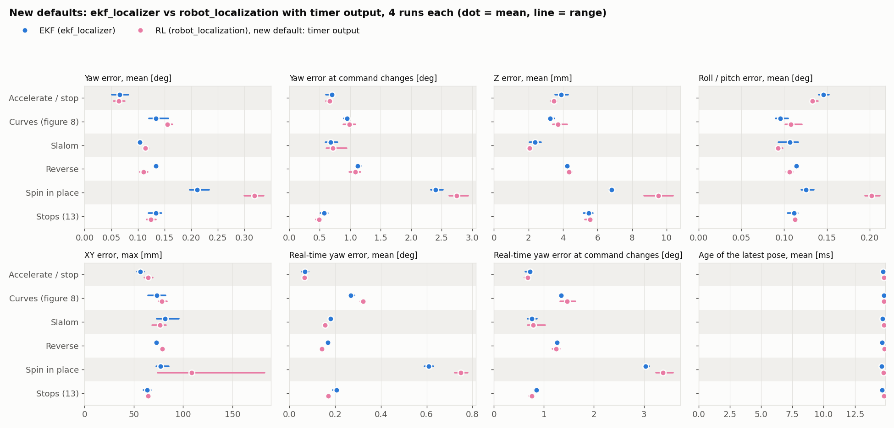

### 24. ekf_localizer に odom_noise_alpha（速さに応じたオドメトリの R）を与えて確かめる

- 目的：オドメトリの R を速さに応じて大きくすると良くなるか（ユーザー指示）。前回（2026-10-11）は移動平均 0.2 s のころの録画だった。
- やったこと：
  - 真値なしで、指令が一定の区間のオドメトリの残差を見た。σ_v は v（0.5〜1.5 m/s）によらず約 0.0001 m/s。σ_ω は |ω| とともに増える
    （0.4 rad/s で 0.002〜0.003、1 rad/s で 0.011 rad/s）。どちらも今の `R_odom`（σ 0.05 m/s、0.071 rad/s）よりずっと小さく、
    当てはめると alpha（ω²→R_ω）は約 1e-4 で効果は出ない見込み。
  - そこで、R が速さではっきり変わる大きさの格子で確かめた（ユーザー判断）。並びは [v²→R_v, ω²→R_v, v²→R_ω, ω²→R_ω]：
    - [0, 0, 0, 0.005]：1 rad/s で R_ω が 2 倍
    - [0, 0, 0, 0.05]：1 rad/s で R_ω が 11 倍
    - [0.005, 0, 0, 0]：1 m/s で R_v が 3 倍
    - [0.005, 0, 0, 0.005]：両方
  - 録画は左右 1 周 + 前進（`spin360_w1_ekf2`）。今の設定（alpha 0）も一緒に流し、どれも 4 回ずつ（ユーザー判断：まず 1 つの動きで）。
  - **最初の再生は無効だった**：
    - 23. の launch の修正（`_scoped`）が `[0, 0, 0, 0.005]` のような整数と小数の混ざったリストをそのまま yaml に書いていた。
      rcl がそれを読めず、`odom_covariance` が起動しなかった（オドメトリなしで動いていた）。
    - 小数にそろえるように直した（localization_bringup 1580e55、未 push）。
    - 再生の評価は、ノードが途中で落ちた回をエラーにするようにした（`tune_run.py`）。
- 結果（4 回の平均（幅）。単位 deg・mm）：

  | alpha | yaw 平均 | 切り替え時の yaw（4 か所の平均） | 回転開始 | 反転 | 回転→前進 | 停止 | z 平均 | 実時間 yaw |
  |---|---|---|---|---|---|---|---|---|
  | 0（今） | 0.22（0.20〜0.24） | 2.37（2.29〜2.40） | 0.78 | 1.93 | 3.90 | 2.87（2.53〜3.00） | 7.4 | 0.60 |
  | ω²→R_ω 0.005 | 0.23（0.22〜0.24） | 2.44（2.41〜2.52） | 0.78 | 1.93 | 3.92 | 3.11（2.99〜3.45） | 7.0 | 0.62 |
  | ω²→R_ω 0.05 | 0.23（0.21〜0.25） | 2.49（2.39〜2.56） | 0.83 | 1.91 | 4.02 | 3.19（2.97〜3.42） | 6.9 | 0.63 |
  | v²→R_v 0.005 | 0.23（0.21〜0.25） | 2.47（2.46〜2.47） | 0.77 | 1.93 | 3.66 | 3.50（3.49〜3.50） | 7.2 | 0.62 |
  | 両方 0.005 | 0.24（0.22〜0.26） | 2.40（2.34〜2.47） | 0.78 | 1.92 | 3.68 | 3.24（2.99〜3.50） | 6.7 | 0.62 |

  - **どの候補も今（alpha 0）より良くならない**。yaw の平均は 0.01〜0.02° 大きく、切り替え時の yaw も同じか少し大きい。
  - v に応じた R は、回転→前進の跳ねを 3.90 → 3.66° に小さくするが、停止の跳ねを 2.87 → 3.50° に大きくする（4 回とも同じ向き）。
  - ω に応じた R の効果が小さいのは、ekf_localizer の omega の Q が 10 と大きいためと考えられる（未確認）。1 周期（20 ms）の予測で
    omega の分散が約 0.2 増えるので、R_ω を 11 倍（0.055）にしてもカルマンゲインは 0.97 → 0.78 で、omega はほぼオドメトリに従う。
  - `gazebo.yaml` は alpha 0 のまま。
  - 時間推移（各候補の中央に近い回）：
    - omega の推定値は、どの候補もほとんど重なる。
    - 回転→前進では、オドメトリの omega が車体より先に 0 になる。停止では、車体がブレーキで −0.45 rad/s 向きを変えるのに、
      オドメトリは逆向きに +0.4 rad/s 振れる。推定はどちらもオドメトリに付いていくので、yaw が 3〜4° 跳ねる（どの候補でも同じ）。
    - 跳ねたあと戻るまでの形は回ごとに違い（NDT の更新のたび段になって戻る）、候補による差より大きい。
    - v に応じた R（両方 0.005）は、前進の立ち上がりで v の推定が少し遅れる。

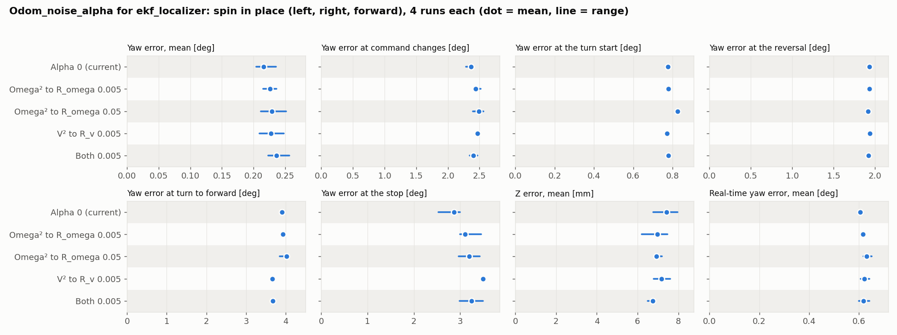

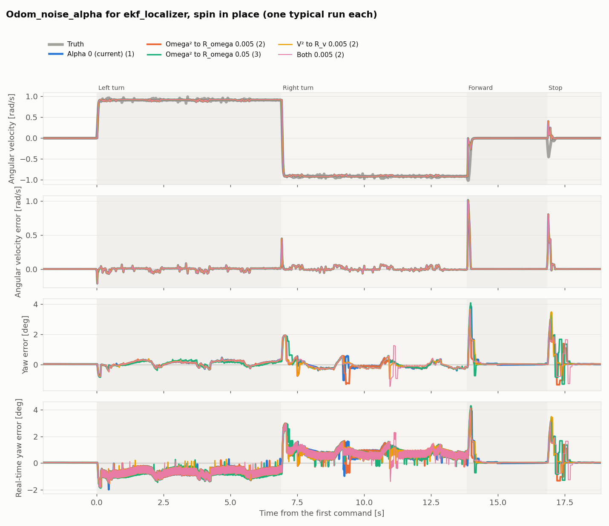

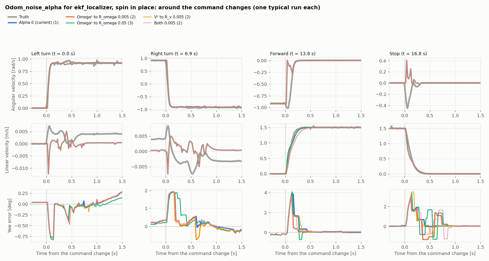

- オドメトリの大きさと R（`plot/plot_odom_r.py`。6 つの録画の、指令が一定の区間ごと）：
  - 真値との差の 2 乗平均は、|ω| とともに増える（0.4〜0.5 rad/s で 3e-5〜1.5e-4、1 rad/s で 5〜6e-4 (rad/s)²）。|v| とも増える
    （0.5 m/s で 0.5〜3e-5、1.5 m/s で 1〜1.5e-4 (m/s)²）。ω² の係数にすると約 5e-4、v² では 5e-5〜1e-4 で、試した alpha（0.005）の
    1/10〜1/100。
  - 真値なしの残差の分散は、さらに 1〜2 桁小さい（一定のずれ・ゆっくりした誤差は局所 1 次式に吸収される）。
  - どれも今の `R_odom`（2.5e-3、5e-3）より 1〜2 桁小さい。区間は指令の変化の 0.5 s 後からなので、速度が変わる瞬間の誤差
    （滑り。停止では omega が逆向き）は入っていない。今の `R_odom` が大きいのは、主にこの瞬間の分を受け持っていると考えられる。
  - 区間の始まりは、オドメトリが指令の変化の半分まで応答した時刻から数えた（後退の録画では最初の指令から 0.7 s 遅れて動き出し、
    加速の途中が入って外れ値になっていた）。

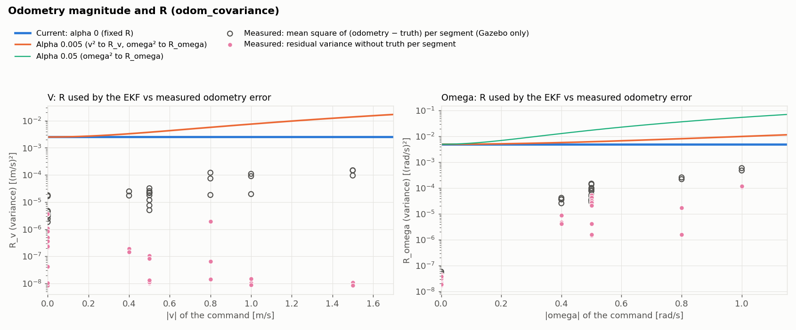

### 25. R_odom をほぼ 0 にして odom_noise_alpha を確かめ直す

- 目的：24. は基準の `R_odom`（2.5e-3、5e-3）に alpha の項を足したので、R は今より大きくなる方向だけだった。基準をほぼ 0 にして、
  R がほぼ alpha の項だけで決まる場合を確かめる（ユーザー指示）。
- やったこと：
  - `R_odom` = [1e-6, 1e-6]（σ 1 mm/s、0.001 rad/s）にして、24. と同じ 4 つの alpha を、左右 1 周 + 前進（`spin360_w1_ekf2`）で 4 回ずつ流した。
  - ちょうど 0 にしないのは、ekf_localizer がメッセージの共分散が正でないと `ekf.yaml` の `R_odom`（2.5e-3）に戻すため
    （止まっているとき R が 0 になり、逆に大きい R になる）。
  - 参考に「`R_odom` ほぼ 0、alpha 0」と今の設定も同じ時間帯に 4 回ずつ流した。
- 結果（4 回の平均（幅）。単位 deg・mm）：

  | 条件 | yaw 平均 | 切り替え時の yaw | 回転開始 | 反転 | 回転→前進 | 停止 | z 平均 | 実時間 yaw |
  |---|---|---|---|---|---|---|---|---|
  | 今（`R_odom` 既定、alpha 0） | 0.22（0.21〜0.23） | 2.40（2.40〜2.40） | 0.77 | 1.93 | 3.90 | 3.00（3.00〜3.01） | 7.3 | 0.61 |
  | `R_odom` 1e-6、alpha 0 | 0.22（0.21〜0.23） | 2.41（2.40〜2.41） | 0.77 | 1.96 | 3.91 | 3.00（2.98〜3.00） | 7.0 | 0.61 |
  | `R_odom` 1e-6、ω² 0.005 | 0.21（0.20〜0.22） | 2.42（2.41〜2.45） | 0.78 | 1.96 | 3.93 | 3.00（2.99〜3.00） | 7.5 | 0.61 |
  | `R_odom` 1e-6、ω² 0.05 | 0.25（0.24〜0.26） | 2.51（2.39〜2.57） | 0.84 | 1.87 | 4.03 | 3.32（2.97〜3.47） | 7.0 | 0.63 |
  | `R_odom` 1e-6、v² 0.005 | 0.22（0.21〜0.25） | 2.47（2.46〜2.50） | 0.78 | 1.98 | 3.65 | 3.47（3.46〜3.50） | 6.5 | 0.62 |
  | `R_odom` 1e-6、両方 0.005 | 0.25（0.24〜0.27） | 2.47（2.47〜2.47） | 0.78 | 1.92 | 3.68 | 3.49（3.47〜3.51） | 7.3 | 0.64 |

  - **`R_odom` をほぼ 0 にしても、yaw はほとんど変わらない**。alpha 0 でも今の設定と同じで、alpha の各候補も 24.（基準 `R_odom` 既定）
    とほぼ同じ値・同じ傾向（v に応じた R は回転→前進 3.90 → 3.65° と小さく、停止 3.00 → 3.47° と大きく。ω² 0.05 は少し悪い）。
  - 理由（計算。ekf_localizer の Q はスペクトル密度で、50 Hz のオドメトリの間に Q·dt 増える）：
    - omega：Q 10 で 1 周期に分散が 0.2 増えるので、定常のカルマンゲインは `R_odom` 5e-3 で 0.976、1e-6 でほぼ 1。
      どちらでも omega はオドメトリにほぼそのまま従う。
    - v：Q 0.05 で 1 周期に 0.001 増えるので、ゲインは 2.5e-3 で 0.46、1e-6 でほぼ 1。v の推定は変わる（拡大図で前進の立ち上がりが
      オドメトリどおりに一気に上がる）が、その場の回転の yaw にはほとんど効かない。
  - yaw の跳ねは、速度が変わる瞬間のオドメトリの omega の誤差（回転→前進で先に 0、停止で逆向き）にそのまま付いていくことで起きる。
    速さ（v², ω²）に応じた R は、この瞬間に大きくならない（停止の瞬間の |ω| は小さい）ので、跳ねを抑えられない。
  - `gazebo.yaml` は変えていない。

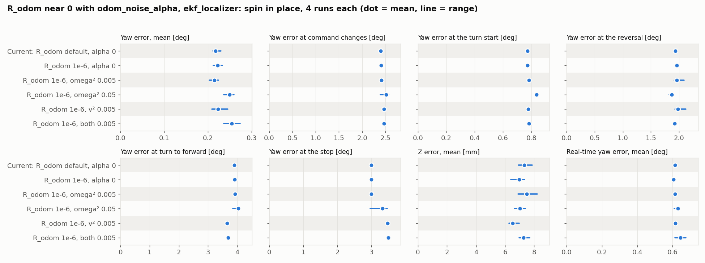

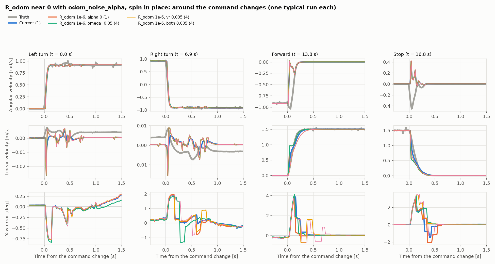

### 26. 録画（bag）を Gazebo と実機で分け、録画ごとに情報を付ける

- 目的：録画が実機か Gazebo か分かるようにする（ユーザー指示。分け方はフォルダ、情報ファイルも付ける）。
- やったこと：
  - `localizer_rl:/root/bags` を `gazebo/`（Gazebo の録画 19 本と phases）・`gazebo/tune/`（その再生の出力 443 本）・`real/`・`real/tune/`
    （実機用。まだ空）に分けた。`/root/bags` に混ざっていた古い図 16 個は `/root/fig_old_from_bags` に移した（消していない）。
  - 置き場所を `localization_tools/eval/bag_paths.py` にまとめ、再生の出力は入力の録画と同じ側の `tune/` に置くようにした。
    結果の行に出力の bag のパス（`out_bag`）を残す。バッチの設定・描き直しのスクリプトなどのパスも書き換えた。
  - `eval/bag_info.py`：各録画の隣に `<名前>_info.yaml` を書く。中身は次のとおり。
    - Gazebo か実機か・録画日時・長さ・大きさ
    - 走らせ方・用途・メモ
    - 録画したときの推定器（出力のトピックから）
    - Gazebo のオドメトリの移動平均：車輪の角速度（`/wheelchair/joint_states`）から計算した omega（直進だけなら v）に
      1 個・10 個の平均を掛け、`/wheelchair/odom` に近いほう
    - omega の真値との比：普段は滑りで 1.06〜1.10。`wheel_separation_multiplier` 1.085 を試した `spin360_mult_rl` は 0.98
  - `run_gazebo_test.sh` は `gazebo/` に録り、録画のあとで情報ファイルを書く（用途は環境変数 `PURPOSE`）。
- 確かめたこと：
  - 移動平均の判定は、分かっている録画で合っていた（移動平均 1 にした後の録画は 1、その前は 10、`make_window_bag.py` で作った
    `spin360_w1_as_w10` は 10）。`joint_states` を録っていない 2026-10-11 の録画は判定できないので、移動平均を 1 にした
    （2026-10-12 00:08〜01:13）より前の録画として 10 と書き、理由をメモに残した。
  - 既存の結果（`results_compare.jsonl`・`results_alpha.jsonl`）を新しい場所の bag から計算し直して同じ値、再生 1 回の出力が
    `gazebo/tune/` に入ること、`results/` の図を全部描き直せることを確かめた。

  | 録画 | 録画日時 | 移動平均 | omega / 真値 | 録画時の推定器 | 用途 |
  |---|---|---|---|---|---|
  | `drive_accel`・`drive_curve`・`drive_slalom`・`drive_reverse` | 10-12 18:10〜18:21 | 1 | 1.06〜1.10 | ekf_localizer | 推定器の比較（22・23） |
  | `spin360_w1_ekf` / `spin360_w1_ekf2` | 10-12 01:13 / 02:23 | 1 | 1.07 | ekf_localizer | 調整用 / 確認用 |
  | `spin360_w1_as_w10` | （`spin360_w1_ekf` から作成） | 10 | 1.06 | なし | 移動平均 1 と 10 の比較（12） |
  | `stops_ekf` | 10-12 03:38 | 1 | 1.08 | ekf_localizer | NDT の R（15）など |
  | `spin360_js_ekf`・`spin360_js_rl` | 10-11 23:49〜10-12 00:07 | 10 | 1.06 | 両方 | 車輪の角速度からのオドメトリ |
  | `spin360_mult_rl` | 10-11 23:01 | 10 | 0.98 | robot_localization | Gazebo の multiplier 1.085 を一時的に試した |
  | `spin360_scale_rl` | 10-11 23:13 | 10 | 1.06 | robot_localization | 推定側の odom_scale（名前からの推測） |
  | `spin360_ekf`・`spin360_rl_base`・`spin360_rl_tuned`・`spin360_ndt_only` | 10-11 19:00〜20:05 | 10 | 1.06 | 各推定器 | 2026-10-11 の調整・比較 |
  | `spin_ekf_localizer`・`spin_robot_localization` | 10-11 18:44〜18:46 | 10 | 1.06 | 各推定器 | 最初の比較（旧版の走らせ方、約 328°） |
  | `live_rl` | 10-11 17:47 | 10 | 1.07 | robot_localization | Gazebo の実走行（26 m） |

  （移動平均 10 の行のうち `spin360_js_*`・`spin360_w1_as_w10` は録画から判定、それ以外は録画日からの推定）

### 27. テスト走行と録画を Gazebo・実機共通にする

- 目的（ユーザー指示）：実機（ラズパイは `acsl-tcu/project_whill`）から必要なトピックを録り、テスト走行と録画を実機・Gazebo の
  両方でできるようにする。置き場所は `localization_tools`（GitHub で管理する）。
- 実機のトピック（project_whill を読んだ。実機では未確認）：
  - whill_driver（`/Drp5_whill_blue/whill_node/`）：`cmd_vel` を受け、左右輪の速度 `motor_speed_ts`・角度 `motor_angle_ts`・
    ジョイスティック `joy_ts`・`speed_mode`・バッテリーを 50 Hz で出す。指令が 1 s 途切れると止まり、ジョイスティックの操作が優先。
  - VLP-16：`/velodyne_points`（**20 Hz**）。
  - RTK-GNSS：`/fix` など。
  - これらと自己位置推定の出力を `drive/config/real.yaml` の録画するトピックにした。
- 作ったもの（`localization_tools/drive/`）：
  - `drive_test.py`：`profiles.yaml` の動き（spin・stops・accel・curve・slalom・reverse）を走らせる。速さは上限に対する割合で、
    直進は距離・旋回は角度・円は半径で決めるので、上限を変えても形・大きさは同じ。
  - `config/gazebo.yaml`・`config/real.yaml`：速さの上限（実機の既定は v 0.5・後退 0.3 m/s・ω 0.5 rad/s。ユーザー指示）、走ってよい範囲
    （両方とも出発時の車体の中心を基準に前 10 m・後ろ 1 m・左右 2 m。ユーザー指示）、指令・姿勢・ジョイスティック・録画のトピック。
  - `run_test.sh gazebo|real <動き> <bag 名>`：Gazebo は起動し直して推定器も起動、実機は推定・whill_driver・LiDAR を確かめてから録る。
    録画は `/root/bags/<target>/` と `_phases.txt`・`_info.yaml`。
  - 安全：
    - 走る前に、計算した軌跡が範囲に収まるか確かめる。
    - 走行中は次のどれかで 0 の指令を出して止める：範囲外、姿勢（実機は `/ekf_pose` を取付で車体に直したもの）が 0.5 s 来ない、
      ジョイスティック、時計の停止、区間 60 s、Ctrl-C・SIGTERM。
    - 実機は計画を表示して `yes` で走り出す。
  - `config/real_in_gazebo.yaml`：実機の設定（上限・`/ekf_pose`・ジョイスティック）を Gazebo で試す予行演習用。
  - 旧版の Gazebo 専用の走行（`gazebo/`）は置き換えた。動きの大きさが変わったので、これまでの録画（`drive_*`・`spin360_*` など）とは
    同じ動きではない。
- 確かめたこと（Gazebo）：
  - 6 つの動きを録画（`test_<動き>`）し、どれも最後まで走って範囲に収まった。いちばん近いのは 8 の字で横に ±1.68 m
    （滑りで半径 0.75 → 0.83 m）。角度は指令どおり（360°・45°・90° とも ±0.5° 以内）。
  - 予行演習（実機の設定）：
    - 後退は最後まで走った。
    - ジョイスティックの入力、推定を止める（0.50 s）、Gazebo を止める（0.51 s）、Ctrl-C で、どれも止まった。
    - Ctrl-C のあと 0 の指令が 25 回出ていることを録画で確かめた。
  - 予行演習で見つけて直した不具合：
    - rclpy が Ctrl-C を処理して通信を先に閉じ、0 の指令を送れていなかった。
    - sim time の時計が止まると、姿勢の古さも区間の時間も進まず止まれなかった。壁時計でも測るようにした。
    - 時計が動き出す前に届いた古い姿勢（transient_local）で、走り出した直後に止まっていた。
  - オドメトリの移動平均の判定は、短い・遅い録画では 1 と 10 の区別がつかないので unknown にするようにした。
- `localization_tools` を GitHub（`MaeharaTakumi/localization_tools`、Public。ユーザー判断）に作って push した。

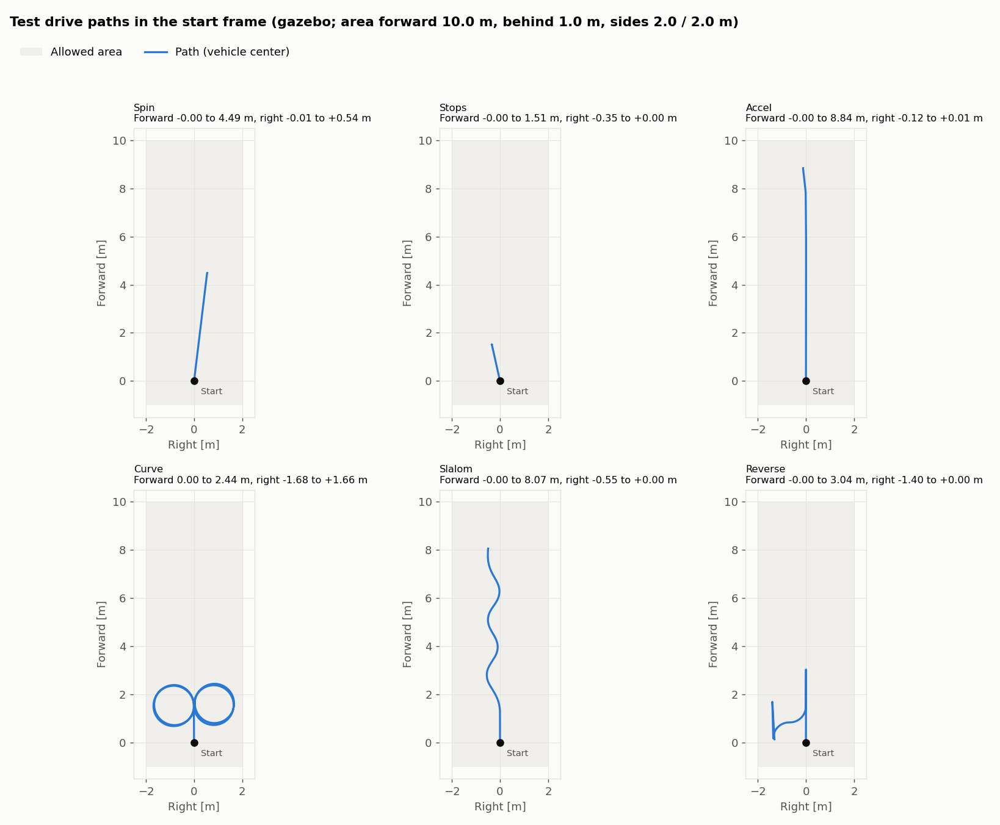

### 28. 実機の車椅子の色を選べるようにし、録画するトピックを絞る

- 車椅子のホスト名を調べた。project_whill のリポジトリにはホスト名が無い（名前空間はラズパイの `${HOSTNAME}`）。
  - MATLAB（`Project-SIP/main` の `ROS2CommManager.m`）は `Drp5_whill_red`・`Drp5_whill_white` の 2 台（`main.m` は white、`main_split.m` は red）。
  - こちらの `real.yaml`・whill_odometry の `config/odometry.yaml`・テスト走行の設定は `blue`、whill_odometry のコードの既定と
    `docs/node_graph.md` は `red` と、食い違っていた。
  - MATLAB は実機でも点群に `/velodyne_points` を使っていた（名前空間なしの想定と合う）。
- やったこと（ユーザー指示：blue・red・white すべて使えるようにする）：
  - 自己位置推定：launch の引数 `whill:=<色>`。`real.yaml` の `topics.motor_speed` を `/{whill}/whill_node/motor_speed_ts` にし、
    既定は `whill: blue`（localization_bringup 24da42d）。`ros2 param get` で、whill_odometry が色ごとのトピックを読むことと、
    違う色で止まることを確かめた。Gazebo の環境は変わらない。
  - テスト走行：`WHILL=<色>`（`drive_test.py --whill`）。`run_test.sh real` は、選んだ色の `cmd_vel` を受けるノードが無ければ、
    見つかった車椅子を表示して止める（localization_tools e9bb183）。
  - 録画から `motor_angle_ts`・`joy_ts`・`speed_mode`・GNSS を外した（ユーザー指示）。録るのは点群・`motor_speed_ts`・`cmd_vel`・
    バッテリーと推定の出力。`joy_ts` は走行中の監視（ジョイスティックで止める）には引き続き使う。

### 29. Docker の定義を更新し、録画と図を ros2_ws の下へ移す

- やったこと（ユーザー指示）：
  - `../localizer_rl_docker` の Dockerfile（b1fe0da。まだ再ビルドしていない）：
    - `BRINGUP_BRANCH` の既定を `robot_localization` に
    - `localization_tools` を `/root/localization_tools` に clone（`TOOLS_BRANCH`、既定 `main`）
    - 録画と図の置き場所 `/root/ros2_ws/bags/{gazebo,real}/tune`・`/root/ros2_ws/fig` を作り、`COLCON_IGNORE` を置く
    - `localization` コマンドで車椅子の色を `WHILL=<色>` で渡せるようにした（今のコンテナの `.bash_aliases` にも入れた）
    - `docker build --check` で書き方を確かめた（問題なし）
  - 今のコンテナの `/root/bags`（4.1 GB）・`/root/fig` を `/root/ros2_ws/bags`・`/root/ros2_ws/fig` へ、古い図を `/root/ros2_ws/fig_old` へ移した。
    ツールの既定のパス、結果の jsonl の `out_bag`、バッチの設定も書き換えた（localization_tools 2 commit）。
- 確かめたこと：
  - 録画の一覧・再生の出力の評価が新しい場所で動く。
  - colcon は録画のディレクトリを探さない（ビルド 0.2 秒、パッケージ数は同じ）。
- 地図も `ros2_ws` の下にそろえた（ユーザー指示。localizer_rl_docker fe964c5）：地図は前から `/root/ros2_ws/map` にあったが、
  `savemap` の保存先と `localization` の地図選択は `/root/map` だった。どちらも `/root/ros2_ws/map` にし、Dockerfile でフォルダを作る。
- 注意：`ros2_ws` もコンテナの中なので、コンテナを作り直すと地図・録画・図は消える。作り直す前に `docker cp` でホストへ退避する。
  使っている地図 `SC10_4_0.05.pcd` はコンテナにしかない（イメージにも入らない）。

## 2026-10-14

### 30. イメージを再ビルドし、コンテナを作り直す

- やったこと（ユーザー指示。ROS 2 は必ず Gazebo 用＝LAN に出ない設定にする。退避先は workspace）：
  - 地図・録画・図・古い図（1,551 ファイル、4.4 GB）と小さい設定（`.ssh/known_hosts`・`.gitconfig`・履歴・RViz など）を
    `workspace/localizer_rl_backup_20261014/` に `docker cp` で退避した。ファイルのパスと大きさが全部一致、地図のハッシュも一致。
    `.vscode-server`（688 MB）は VS Code が入れ直すので除いた。
  - 前のイメージに `localizer_rl:20261011` を付けて残し、`docker compose build`（localizer_rl_docker fe964c5）→ `docker compose up -d` で作り直した。
    新しいイメージ：9 パッケージのビルド成功、localization_bringup は robot_localization（24da42d）、ekf_localizer は 2739d6d、
    localization_tools は main、`.bashrc` の通信設定は Gazebo 用。
  - 地図・録画・図を戻し（パスと大きさが一致）、履歴・RViz の設定・`known_hosts` を戻した。
- 確かめたこと：
  - **通信が LAN に出ない**：コンテナで talker・listener を動かし、ホストから見た。
    - DDS（ROS_DOMAIN_ID 11 のポート 10150 番台）のソケットは `127.0.0.1` だけ。
    - ノードの UDP のソケットは、送信用も含めて全部 `127.0.0.1`。TCP は無し。
    - 有線・無線の LAN で DDS のマルチキャスト（239.255.0.1）に参加していない。
  - robot_localization の合成データのテストが通った。表示は、timer の既定に合わせて直した。
  - Gazebo のテスト走行と録画（`rebuild_check_spin`）が最後まで動き、推定も作り直す前と同じ程度だった
    （yaw 平均 0.26°、作り直す前の `test_spin` は 0.28°）。

### 31. コンテナ名を test_maehara にする

- やったこと（ユーザー指示）：
  - 動いているコンテナを `docker rename localizer_rl test_maehara` で名前だけ変えた（作り直していないので、地図・録画などはそのまま）。
  - `docker-compose.yml` の `container_name` を `test_maehara` にした。イメージ名（`localizer_rl:latest`）・compose のプロジェクト名・
    リポジトリ名（`localizer_rl_docker`）は変えていない。
  - localization_tools（`sync.sh`・`drive/run_test.sh` のコンテナ名など）、CLAUDE.md、Docker の README のコンテナ名を変えた
    （開発ログの過去の記録は当時の名前のまま）。
- 確かめたこと：名前を変えたあとも ROS の設定（Gazebo 用）・地図・録画が残り、`sync.sh push` と録画の一覧が動いた。
- 注意：compose の設定と名前が変わったので、次の `docker compose up -d` でコンテナが作り直される（先に退避する）。

### 32. localization_tools を ros2_ws の下へ移す

- やったこと（ユーザー指示）：コンテナの `/root/localization_tools` を `/root/ros2_ws/localization_tools` へ移した（src の外）。
  リポジトリの直下に `COLCON_IGNORE` を置いた（colcon が中を探さない）。`sync.sh`・`drive/run_test.sh`・`plot/rerender_results.sh`
  の置き場所、Dockerfile の clone 先、README・CLAUDE.md を直した（localization_tools・localizer_rl_docker に commit）。
- 確かめたこと：新しい場所で `sync.sh push`・計算した軌跡の確認・録画の一覧が動き、colcon のパッケージ数は 9 のまま。
  Dockerfile は `docker build --check` で問題なし（再ビルドはしていない。今のコンテナは中で移した）。

### 33. run_test.sh をコンテナの中からも動かせるようにする

- 目的：実機の PC で自己位置推定のコンテナの中から `WHILL=red ./drive/run_test.sh real spin ...` を実行すると、
  `docker: command not found` で止まった（ホストから `docker exec` で動かす作りだったため）。
- やったこと（`localization_tools/drive/run_test.sh`）：
  - docker があればホスト、無ければコンテナの中と判定する。中では `docker exec` を使わずその場で動かし、
    スクリプトのある `localization_tools` を使う（置き場所は `/root/localization_tools` でもよい）。`sync.sh push` もしない。
  - Gazebo のとき、中からは Gazebo を起動し直せないので、`/wheelchair/odom` が来ることだけ確かめる（車椅子は初期位置に置いておく）。
  - 裏で動かす録画・推定は、SIGINT を既定に戻してから起動する（中からでも `pkill -INT` で止まる）。
  - `ros2 topic` は全部 `--no-daemon` にした。確認の途中で、`timeout` の中で最初の `ros2` が CLI のデーモンを起動し、
    デーモンが `timeout` のプロセスグループに入って時間切れのシグナルで壊れた（以後の `ros2 topic` が `!rclpy.ok()` で落ちる）。
- 確かめたこと（Gazebo、`spin`）：3 通りとも最後まで走り、録画・`_info.yaml` ができ、推定のプロセスは残らなかった。
  - ホストから：左 360.3°・右 360.1°・前進 4.31 m。
  - コンテナの中から：左 360.3°・右 360.5°・前進 4.32 m。
  - コンテナの中から実機の流れ（`CONFIG=real_in_gazebo`、走り出しの確認に yes）：実機の上限（0.5 rad/s・0.5 m/s）で
    左 360.0°・右 360.4°・前進 1.47 m。指令を受けるノードと録画するトピックの確認も動いた。
    この録画は Gazebo なので `bags/gazebo/runner_inside_realflow` に移した。
- 実機の PC では、コンテナの中の clone を `git pull` してから、コンテナの中で `WHILL=red ./drive/run_test.sh real spin <bag 名>`。

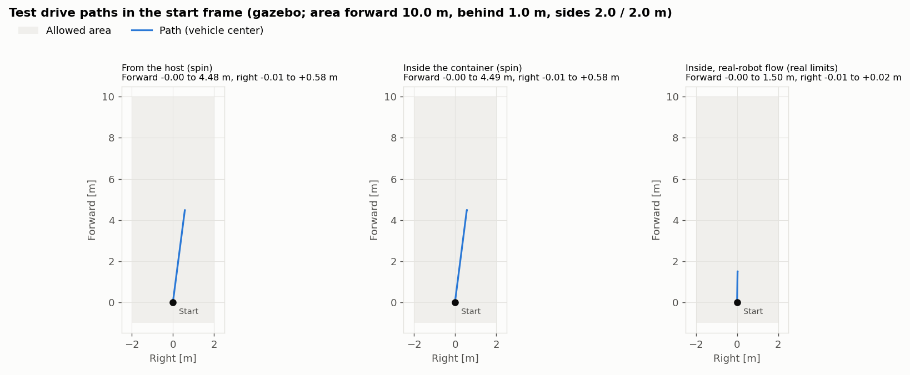

### 34. コンテナ（test_maehara）の中を整理する

- 目的（ユーザー指示）：コンテナの中の重複を消し、仕様の不統一を直す。構成の提案もする。
- 調べたこと：`/root` の下を全部（`ros2_ws` の src・bags・fig・fig_old・map・localization_tools・log、ドットファイル、`/tmp`）。
  同じ中身のファイル（md5）、どこからも使われていない再生の出力、録画の情報ファイルの書き方、ホストとの違い。
  src の 5 つのリポジトリ・localization_tools はホスト・GitHub と同じ中身だった。
- 直したこと：
  - **結果の写し漏れ**：古い置き場所 `bags/gazebo/tune/results*.jsonl` にだけ残っていた 5 行（`results_hv` の hv_avg_* 4 行、
    `results` の final_replay）を `eval/results` に戻した。これで tune の 9 個の jsonl は全部 `eval/results` に含まれる（重複）。
  - **図を全部描き直せるように**：`rerender_results.sh` が results の 73 個のうち約 30 個を作っていなかった。再生の比較 7 組、qr_unstable、
    真値なしの R、取付と倍率、runner_paths を加えた（NDT の R は約 9 分かかるので `FULL=1` のときだけ）。描き直すと
    数値は同じで、json に残る録画のパスだけが今の置き場所（`/root/ros2_ws/bags/gazebo/...`）になった。
  - **録画の情報の書き方**：古い録画の `drive`（`drive_spin.py` など、削除済みのスクリプト）を、今の書き方（localization_tools からの
    パス）にそろえ、削除した commit（b4edf7e）を書いた。予行演習 3 つの用途が名前だけ（「予行演習：rehearsal_clock」）だったので、
    何を確かめたか（Gazebo を止める・推定を止める・Ctrl-C）に直した。メモが消えたログ（`localizer_rl:/tmp/...`）を指していたのも直した。
  - **走行のログを録画の隣に残す**：`run_test.sh` は drive_test.py の出力を `/tmp` にだけ書いていた（コンテナを作り直すと消える）。
    `<bag 名>_drive.log` として録画の隣に写すようにした。残っていた 4 つ（runner_*、rebuild_check_spin）も写した。
    `runner_host_spin` を録り直して確かめた（左 360.2°・右 360.3°・前進 4.32 m）。
  - **一時ファイルが溜まる**：launch がパラメータの一時 yaml を `/tmp` に残し続けていた（launch 1 回で 4〜7 個）。launch ごとの
    ディレクトリに置き、launch が終わるときに消すようにした（localization_bringup 91bde11。合成データのテストで、動いている間はあり、
    終わると消えることを確かめた）。合成データのテストが src の scripts に `__pycache__` を作っていたのも止めた。
  - コンテナの中の localization_tools の git が古い commit を指していた（ファイルは最新）ので、GitHub の最新に合わせた。
- 消すもの（完全な削除なのでユーザーが行う）：重複した `bags/gazebo/tune/*.jsonl`（9 個）、`fig_old`（17 個。16 個は fig に新しい版がある）、
  `/tmp` に残った launch の一時 yaml（23 個）、src の scripts の `__pycache__`。

### 35. 録画・地図・図をホストに置き、確認用の録画を分ける

- 目的（ユーザー指示。34 の提案の 1〜4）：コンテナを作り直しても録画・地図・図が消えないようにする。比較・調整に使う録画と
  ツールの動作確認の録画を分ける。使われていないファイルを消す。git に入っていたバイトコードを外す。
- やったこと：
  - **確認用の録画を `check/` へ**：予行演習 5・run_test.sh の確認 3・作り直しの確認 1 の計 9 個を `bags/gazebo/check/` に移した。
    `run_test.sh` は bag 名を `check/<名前>` にするとそこに録り、`bag_info.py list` は `check/` も表示する（localization_tools a780181）。
  - **データをホストへ**：`/root/ros2_ws/{bags,map,fig}` と `fig_old` を `docker cp` で `localizer_rl_docker/data/` に写した
    （1,572 ファイルの md5 とディレクトリの構成が全部一致）。`docker-compose.yml` で `data/{bags,map,fig}` を割り当て、
    `.gitignore`・`.dockerignore` で git にもビルドの入力にも入れない（ビルドの入力は 161 B）。`docker compose up -d` でコンテナを
    作り直した（ID a5e7c1e23e8a、イメージは同じ）。localization_tools の移動、localization_bringup の反映とビルド、
    履歴・RViz・`known_hosts` の復元をした（localizer_rl_docker 784cb0d）。
  - **バイトコード**：localization_bringup の `launch/__pycache__/*.pyc` を git から外し、`.gitignore` を足した（23767ee。humble には残っている）。
- 確かめたこと：
  - ROS 2 は Gazebo 用のまま。talker・listener のソケットは送信用も含めて全部 `127.0.0.1`（UDP 10160〜10163 と送信用 1 つずつ）、TCP なし、
    有線・無線の LAN で 239.255.0.1 に参加していない。
  - colcon のパッケージは 9 個のまま。合成データのテストが通り、launch の一時 yaml も残らない。
  - Gazebo のテスト走行（`check/volume_check_spin`：左 360.1°・右 360.1°・前進 4.32 m）がホストの `data/bags/gazebo/check/` に録れた
    （ファイルはホストでは root の持ち物）。
- 消すもの（完全な削除なのでユーザーが行う。どれもホストのユーザーの持ち物）：重複した `data/bags/gazebo/tune/*.jsonl`（9 個）、
  `data/fig_old`、使われていない再生の出力 6 個（約 19 MB）。34 で挙げた `/tmp` の一時 yaml と `__pycache__` は作り直しで無くなった。

### 36. テスト走行の動き spin5（5 周の回転）を足す

- 目的（ユーザー指示）：5 周回るテスト走行を用意する（録画はしない）。
- やったこと：`drive/profiles.yaml` に `spin5` を足した。その場で左に 5 周 → 右に 5 周 → 3 秒前進で、速さは `spin` と同じ上限。
  1 周ずつの区間にした（実機の 0.5 rad/s で 5 周を 1 区間にすると約 63 s で、1 区間の上限 60 s を超えて止まる）。
  各方向の最初の周を `left turn`・`right turn` にしたので、`spin` と同じ名前で回転の始まり・反転・前進への切り替えが分かり、
  今の評価・描画（`tune_run.py`・`plot_spin.py` など）がそのまま使える（localization_tools cf719bd）。
- 計算した軌跡（`--simulate`）：Gazebo は計 71 s（1 周 6.8 s）、実機は計 129 s（1 周 12.6 s）、どちらも範囲内（前 4.5 m・1.5 m）。
  区間の変わり目で指令は途切れない。1 周ごとに測るので、終わりの行き過ぎ（1 周あたり 0.1〜0.5° 程度）は 5 周分たまる。

### 37. 実機で WHILL を付けると run_test.sh が動きを読めない不具合を直す

- 目的：実機で `WHILL=red ./drive/run_test.sh real spin5 ...` が `drive_test.py: error: unrecognized arguments: spin5` で止まった。
- 原因と直したこと：
  - `run_test.sh` は `drive_test.py real --whill red spin5` の順に渡す。Python の argparse の `parse_args` は、省略できる位置引数（動き）が
    オプションの後にあると受け取れない。`WHILL` を付けたときだけ起き、これまでの確認では付けていなかったので見逃していた。
    `parse_intermixed_args` にした（`run_test.sh` が使う 7 通りの呼び方で確かめた）。
  - 確かめる途中で、`/ekf_pose` の確認が 10 回に 1 回「トピックの型が分からない」で失敗することが分かった（`--no-daemon` では
    トピックを探す時間が既定 0.5 s）。`run_test.sh` の `ros2 topic` を全部 `--spin-time 3` にした（20 回とも成功）。
- 確かめたこと：実機の流れ（コンテナの中から、`WHILL=red CONFIG=real_in_gazebo`、上限 0.5 rad/s）で Gazebo の車椅子に `spin5` を走らせた
  （`bags/gazebo/check/whill_arg_spin5`）。10 周とも 1 周 360.0〜360.4°（約 13.9 s）、前進 1.49 m で最後まで走った。
- 実機の PC では、push のあとコンテナの中の localization_tools を `git pull` する（`spin5` もそのとき入る）。
- 2026-10-15：別の PC でも同じ修正（91504d8、`parse_intermixed_args`）が push されていたので、マージした（910c56d）。同じ行が重なったが
  コードは同じで、説明の詳しいこちらのコメントを残した。

## 2026-10-15

### 38. robot_localization を廃止し、ファイルを整理する

- 目的（ユーザー指示）：robot_localization（2 段 EKF）に切り替えて比べる機能をやめ、ekf_localizer だけにする。
  比べた結果（23）では、ほとんどの動きで同じ、その場の回転・曲線では ekf_localizer のほうが良かった。
- やったこと（ユーザーの判断：humble にマージ、Docker の名前も変える、過去の robot_localization のデータは消す）：
  - **localization_bringup**：`estimator` 引数、robot_localization の起動、`robot_localization_adapter.py`、`robot_localization.yaml`、
    `gazebo.yaml` の `ekf_filter_node_*`、依存を外し（e22ed8f）、humble に早送りでマージして push した。以後 humble で開発する。
    `robot_localization` ブランチは廃止前の 23767ee のまま残した。オドメトリの共分散・倍率（`odom_covariance`）、
    `joint_state_odometry`、車椅子の色の選択、パラメータの上書きの修正は humble に入った。
  - **localization_tools**（476480a）：`tune_run.py`・`compare_run.py`・`tune_batch.py`・`run_test.sh` から `estimator` を外した。
    評価・描画が robot_localization の adapter から借りていた姿勢の計算を `eval/pose_math.py` に移した。
    合成データのテスト・`replay.sh`・`plot_scale.py`・`qg.json` と、候補の robot_localization の項目（とそれだけのファイル 6 個）、
    結果の robot_localization の行 191 行を消した（git の履歴には残る）。`rerender_results.sh` から robot_localization を含む図を外した
    （`results/` の図は開発ログの記録として残す）。録画するトピックから `/odometry/*` を外した。
  - **Docker**：`ros-humble-robot-localization` を外し、localization_bringup の既定を humble に戻した。GitHub のリポジトリ名を
    `localizer_rl_docker` → `localizer_docker` に変え（古い URL は転送される）、イメージを `localizer_maehara:latest`、
    コンテナを `test`、compose のプロジェクトを `localizer_maehara` にした（86c9ae8）。ホストのディレクトリも `Docker/localizer_docker`。
- 確かめたこと（作り直す前のコンテナで）：ツールの全スクリプトのコンパイル、図の描き直し（43 枚）、新しい呼び方の `tune_run.py` での
  再生（`spin360_w1_ekf2`。跳ねは回転開始 0.79°・反転 1.99°・回転→前進 3.90° で前と同じ程度）、Gazebo のテスト走行
  （`check/norl_check_spin`：左 360.4°・右 360.0°・前進 4.31 m）。
- 作り直し（ユーザーの確認のうえ）：push（localization_bringup の humble、localization_tools の main、Docker）、GitHub の名前の変更のあと、
  イメージ `localizer_maehara:latest` をビルドし（9 パッケージ）、`test_maehara` を外してコンテナ `test`（55e37016c9b9）を作った。
  履歴・RViz・`known_hosts`・`.gitconfig` を戻した。録画・地図・図はホストの `localizer_docker/data` なのでそのまま。
- 作り直したあとに確かめたこと：
  - ROS 2 は Gazebo 用のまま：talker・listener のソケットは送信用も含めて全部 127.0.0.1、TCP なし、LAN で 239.255.0.1 に参加していない。
  - localization_bringup は humble（e22ed8f）、localization_tools は `/root/ros2_ws/localization_tools`（476480a）、robot_localization の
    パッケージは入っていない。colcon のパッケージは 9 個。
  - Gazebo のテスト走行（`check/rebuild_test_spin`：左 360.4°・右 360.1°・前進 4.32 m）が最後まで動き、推定のプロセスは残らなかった。
- 消したもの（ユーザーが実行）：robot_localization の録画 7 個と再生の出力 193 個（約 1.4 GB。bag の中身で robot_localization の出力と
  確かめたものだけを並べたスクリプト）、前のイメージ `localizer_rl:latest`。残りは録画 18 個・再生の出力 246 個（3.6 GB）で、
  robot_localization の出力を含むものは無い。

### 39. 実機の環境を車椅子の色ごとにする（env:=red・blue・white）

- 目的（ユーザー指示）：自己位置推定の起動で、環境（`env:=real`）と車椅子の色（`whill:=<色>`）の 2 つを指定していたのを、
  `env` 1 つにまとめる。`real.yaml` を `red.yaml` にし、`env` の既定を `red` にする。
- やったこと：
  - localization_bringup（bcf0aab）：`param/env/real.yaml` → `red.yaml`（`whill: red`）。色だけが違う `blue.yaml`・`white.yaml` を足した
    （実機の設定を変えるときは 3 つとも直す）。launch の `whill` 引数を外し、色は環境ファイルの `whill` で決める。`env` の既定は `red`。
  - Docker（d3facce）：`localization` コマンドは `WHILL=<色>`（既定 red）を `env:=<色>` にして起動する（今のコンテナにも写した。
    イメージには次のビルドで入る）。
  - テスト走行（localization_tools 05172f5）：`drive/config/real.yaml` の既定の色を blue → red（`WHILL=<色>` は今までどおり）。
- 確かめたこと（コンテナ `test`、`ROS_DOMAIN_ID=99`）：引数は `env`（既定 red）・`use_ekf`・`map_path`・`rviz`。既定・`env:=white`・
  `env:=blue` で起動すると、whill_odometry の入力がそれぞれ `/Drp5_whill_red|white|blue/whill_node/motor_speed_ts` になった。
  `env:=gazebo` も今までどおり起動した。

### 40. 環境ファイルの whill と、odom_covariance の odom_delay を外す

- 目的（ユーザー指示）：実機の環境が車椅子の色ごとのファイル（39）になったので、環境ファイルの `whill` と、`topics` の `{whill}` を
  `Drp5_whill_<色>` に置き換える仕組みは要らない。`odom_covariance` の `odom_delay` は ekf_localizer の `odom_delay` と同じことを
  していた（robot_localization にも効かせるために足したもの）ので外す。
- やったこと：
  - localization_bringup：`red.yaml`・`blue.yaml`・`white.yaml` の `whill` を消し、`topics.motor_speed` を
    `/Drp5_whill_<色>/whill_node/motor_speed_ts` と直接書いた。launch の置き換えを消した。
    `odom_covariance` の `odom_delay`（stamp を戻す処理）を消し、`gazebo.yaml` の遅れの説明は ekf_localizer の `odom_delay` に移した。
    遅れの補正は ekf_localizer の `odom_delay` だけになった（Gazebo・実機とも 0）。
  - localization_tools：過去の候補ファイル 7 個・27 項目の `odom_covariance.odom_delay` を、同じ効果の `ekf_localizer.odom_delay` に書き換えた
    （stamp を戻すのと ekf_localizer が同じだけ戻すのは同じ計算。両方に値があった項目は無い）。
- 確かめたこと：`env:=red`（既定）・`env:=blue` で whill_odometry の入力が `/Drp5_whill_red|blue/...` になり、`odom_covariance` の
  パラメータから `odom_delay` が消えた。Gazebo のテスト走行（`check/nowhill_nodelay_spin`：左 360.5°・右 360.5°・前進 4.32 m）が
  最後まで動き、精度は変更前（`check/rebuild_test_spin`）と同じ程度（yaw の平均 0.18° 対 0.24°、切り替え時の跳ね 2.0° 対 2.5°、z 7 mm）。

### 41. テスト走行の設定も車椅子の色ごとにし、時刻同期と ekf_localizer の README を直す

- 目的（ユーザー指示）：テスト走行の `whill`（`WHILL`・`--whill`・`{whill}`）も外す。実機は時刻同期しているので
  `cloud_stamp_correction: none` が正しい。ekf_localizer の README の値を `ekf.yaml` に合わせる。
- やったこと：
  - localization_tools（2c4d0e2）：`drive/config/real.yaml` を `red.yaml` にし、トピックの `Drp5_whill_<色>` だけが違う `blue.yaml`・
    `white.yaml` を足した。`run_test.sh <gazebo|red|blue|white> <動き> <bag 名>` で、自己位置推定の `env:=<色>` と同じ指定になった。
    録画は今までどおり実機は `bags/real`。情報ファイルの `drive` に target（色）も書く。知らない target は使える名前を表示して止める。
  - localization_bringup（90cc1a7）：環境ファイル・README の「時計は同期していない」を「時刻同期している（`none`）」に直した。
    ノードの図（`docs/node_graph.md`）に、オドメトリが `odom_covariance`（`/localization/odom`）を通ることを描き、実機の図から使っていない
    `cloud_stamp_corrector` を外した（`estimate`・`receipt` のときだけ入る）。
  - ekf_localizer（227b490、ユーザー指示）：README の `predict_rate` 20.0・`gate_ndt` 1.0e5・`gate_odom` 1.0e5・`odom_delay` 0.0 を
    `ekf.yaml` に合わせ、コードの既定も書き添えた。
- 確かめたこと：Gazebo（`run_test.sh gazebo spin check/color_target_gazebo`：左 360.3°・右 360.4°・前進 4.32 m）と、実機の流れを
  Gazebo で（コンテナの中から `CONFIG=real_in_gazebo run_test.sh red spin`、上限 0.5 rad/s：左 360.4°・右 360.2°・前進 1.46 m）が最後まで動いた。
  `drive_test.py` は red・blue・white で `/Drp5_whill_<色>/whill_node/cmd_vel` を使う。
- `estimate` の動き（`cloud_stamp_corrector`）：点群ごとに d = 受信時刻 − stamp（時計のずれ + 通信の遅れ）を計り、直近 10 s の
  d の最小値を「時計のずれ + 最小の遅れ」とみなして、stamp + その値（受信時刻を超えない）を点群の時刻にする。d が今の最小値より
  0.5 s 以上大きい状態が 5 回続くと、相手の時計が戻ったとみなして推定し直す。

### 42. 点群の時刻の estimate と、whill_odometry の時刻 0 の代わりの処理を廃止する

- 目的（ユーザー指示）：実機は時刻同期しているので、時計のずれを推定して直す `estimate` は要らない。`motor_speed_ts` の時刻が
  0 になることが無くなったので、whill_odometry の「時刻 0 のときは受信時刻で代える」処理も要らない。
  （`estimate` は時刻同期していても、点群の時刻を最小の通信の遅れの分だけ遅らせる。名前を `auto` にする案は、
  「必要なときだけ直す」と読めて誤解を招くので採らなかった。点群の時刻の設定はオドメトリには効かない）
- やったこと（lidar_localization・whill_odometry を workspace に clone した）：
  - lidar_localization（70414e4）：`cloud_stamp_corrector` を、受信した時刻（− `min_transport_delay`）にするだけのノードにした。
    `mode`・`window`・`jump_threshold`・`jump_count` を外した。
  - localization_bringup（04438c9）：`cloud_stamp_correction` は `none`・`receipt` だけ。`receipt` のときだけ `cloud_stamp_corrector` を起動し、
    `estimate` などほかの値は分かるエラーで止める。
  - whill_odometry（2c6b34e）：`use_stamped_input: true` なら入力の stamp をそのまま使う（0 のときの代わりの処理を外した）。
- 確かめたこと（コンテナ `test`、`ROS_DOMAIN_ID=99`）：3 パッケージをビルドした。`cloud_stamp_corrector` は入力の時刻（1000 s）に関係なく
  受信した時刻を付けた。whill_odometry は時刻 0 の入力の出力も 0（受信時刻にしない）、2003 s の入力は 2003 s、v は 1.0 m/s で正しい。
  環境ファイルを `estimate` にすると「none・receipt だけ」と出て止まり、`receipt` なら `cloud_stamp_corrector` が起動した。

### 43. 点群とオドメトリの時刻を clock_synced（true / false / auto）でそろえて決める

- 目的（ユーザー指示）：時刻の扱いを `clock_synced` 1 つにし、NDT（点群）とオドメトリでそろえる。`true` は stamp をそのまま、
  `false` は受信した時刻、`auto` は PC の時刻と 0.1 s 以上ずれていたら受信した時刻・ずれていなければ stamp。
- やったこと：
  - localization_bringup（63789e6）：環境ファイルの `cloud_stamp_correction` を `clock_synced` に置き換えた（残っていれば分かるエラー）。
    実機（red・blue・white）・Gazebo とも `true`。しきい値は `clock_offset_threshold`（既定 0.1 s）。`odom_covariance` に `stamp_mode`
    （stamp / receipt / auto）を足した（Gazebo・実機のどちらのオドメトリもここを通る）。
  - lidar_localization（eba69f6）：`cloud_stamp_corrector` に `mode`（receipt / auto）と `auto_threshold` を足した。`auto` は受信した時刻を
    使った数とずれの最大を 10 s ごとにログに出す。
  - sim time で `/clock` を受け取る前（今の時刻が 0）は、どちらも stamp のまま渡す。最初の版では Gazebo の起動直後の約 1 s、
    オドメトリ 49 回の時刻を 0 にしていた（ずれ 7040 ms と出た）ので直した。
- 確かめたこと（コンテナ `test`）：
  - 作ったメッセージ（受信の 0.02 s 前・0.5 s 前・0.3 s 後・1000 s）で、`receipt` は全部受信した時刻、`auto` は 0.02 s 前だけ stamp のまま、
    `stamp` は全部そのまま（点群・オドメトリとも同じ）。
  - launch：`true` → `cloud_stamp_corrector` なし・`stamp_mode: stamp`、`false` → receipt・receipt、`auto` → auto・auto。
  - Gazebo を `auto` で 1 周ずつ走らせると、受信した時刻 − stamp は点群 −4〜+7 ms（230 回）、オドメトリ 0 ms（1487 回）で、
    受信した時刻に切り替わったのは 0 回。既定（`true`）のテスト走行（`check/clock_synced_true`）も最後まで動き、精度は同じ程度
    （yaw の平均 0.21°、切り替え時の跳ね 2.3°）。
- 注意：実機の点群は、ラズパイで 1 回転分（20 Hz で 50 ms）をまとめてから LAN で送る。stamp が 1 回転の始めの時刻なら、時刻同期していても
  受信した時刻 − stamp は 50 ms + 転送の時間になり、0.1 s に近づくかもしれない（未測定）。`auto` を使う前に、ログの
  「receipt time used for …」で確かめる。

### 44. オドメトリのパラメータの置き場所をほかとそろえる

- 目的（ユーザー指示）：whill_odometry の設定だけ `config/`（NDT・EKF は `param/`）で、`odom_covariance` の値だけ
  localization_bringup の `param/odom_covariance.yaml` にあった。ほかと同じ置き方にする。
- やったこと：
  - whill_odometry（`config/odometry.yaml` → `param/odometry.yaml`）。launch と `odom_params` コマンド（Docker）も合わせた。
  - localization_bringup：`param/odom_covariance.yaml` をやめ、`R_odom`・`odom_noise_alpha`・`R_odom_other`・`accel_noise_tau`・`odom_scale` を
    `gazebo.yaml`・`red.yaml`・`blue.yaml`・`white.yaml` の `parameters.odom_covariance` に書いた（値は同じ。Gazebo の倍率だけ [1, 0.922]）。
    時刻の `stamp_mode`・`auto_threshold` は launch が `clock_synced` から入れる。
- 確かめたこと：`env:=red` で odom_covariance の `R_odom` [0.0025, 0.005]・`odom_scale` [1, 1]、whill_odometry の `tread_width` 0.495・
  `use_stamped_input` true、`env:=gazebo` で `odom_scale` [1, 0.922]。whill_odometry 単体の launch も新しい場所を読んだ。
  Gazebo のテスト走行（`check/odom_params_env`）が最後まで動いた（yaw の平均 0.27°、切り替え時の跳ね 2.7°。同じ値の前 3 回は 0.18〜0.24°・
  2.0〜2.5° で、走行ごとのばらつきの範囲）。

### 45. localization_tools のコマンドを足す

- 目的（ユーザー指示）：テスト走行・録画の一覧を、`localization` などと同じくコマンドで呼べるようにする。
- やったこと（localizer_docker の `src/aliases.txt`）：`test_drive`（`drive/run_test.sh`）、`test_list`（動きの一覧。
  `test_list red spin5` で走る前の計画）、`bags`（録画の一覧。`bags --source real` で実機だけ）。
  名前に空白は使えず、`test` はシェルの組み込み（`test -d` など）なので `_` を付けた。今のコンテナにも写した（イメージには次のビルドで入る）。
- 確かめたこと：コンテナ `test` で 3 つとも動き、組み込みの `test` もそのまま使える。
- 2026-10-15：ユーザー指示で `bags` を `bags_list` にし、`bags_list real`・`bags_list gazebo` で絞れるようにした。
- 2026-10-15：ユーザー指示で `localization` コマンドを `localization [red|blue|white|gazebo]`（既定 red）にした（環境変数 `WHILL` をやめた）。
  無い名前は使える環境を表示して止める。`scanmatch_cli <地図> white` で white.yaml・地図が渡ることを確かめた。
- 2026-10-15：ユーザー指示で `localization white SC10_4_0.05` のように地図も渡せるようにした（選ぶ画面を出さない。名前なら `/root/ros2_ws/map/` の中、
  `.pcd` は省ける、パスでもよい。無い地図は地図の一覧を表示して止める）。`white.yaml` と地図が launch に渡ることを確かめた。
- 2026-10-15：ユーザー指示で Docker の README（コマンドの一覧など）をコンテナの `/root/README.md` にも入れた（Dockerfile の COPY。今のコンテナにも写した）。
- 2026-10-15：ユーザー指示で、その README の置き場所を `/root/ros2_ws/README.md` に変えた。
- 2026-10-15：ユーザー指示で `test_drive`・`test_list` を `drive`・`drive_list` にし、bag 名を省くと `<target>_<動き>_<年月日_時分秒>` を付けるようにした
  （`run_test.sh` 自体で。始めに `== bag: <名前>` と表示する）。

### 46. パラメータ推定用の動きと、R_odom を直進と車輪の間隔から求める

- 目的（ユーザー指示）：
  - R_odom の v は定速の直進から求め、omega は v の R と車輪の間隔から計算する。
  - 観測ノイズの推定で、残差のヒストグラムと正規分布の図を出す。
  - パラメータ推定専用の動きを作り、推定とセットで回す。速度・角速度・秒数・回転数は param ファイルで設定する。
- やったこと（localization_tools）：
  - `noise/estimate_noise.py`：
    - R_v は直進の区間の v の残差（x 積分相関時間）から求める。
    - R_omega = 4 R_v (s_omega/s_v)² / b²（左右の車輪のノイズが独立で同じ大きさと仮定。b は `--tread`、s は今の倍率）。
    - 直接測った omega の残差も並べる。
  - ヒストグラム `_hist.png`（`plot_noise.plot_hist`）：
    - 残差（確率密度）に、残差の σ（R に使う値）と頑健な σ（1.4826 x 中央絶対偏差）の正規分布を重ねる。尖度と ±4.5 σ の外の点の数も書く。
    - `ndt_init_noise.py` も同じ図を出す。`--from-json` で、計算し直さずに図だけ描ける。
  - 動き `calib`（`drive/profiles.yaml` の `generate: calib`）：値は `param/calib.yaml` の `motion`（Gazebo・実機で共通の 1 組。ユーザー指示）。
    - 順番：止まる 5 s → その場で左右に 2 周ずつ（0.4 rad/s）→ 0.4 m/s x 15 s の直進を 2 往復（折り返しは 180°）。
    - 上限を超える値なら走らない。
  - `calib/run_calib.sh <target>`（コマンド `calib`）：走って録画し、続けて `calib/estimate_all.py`（コマンド `calib_estimate`）で推定する。
    - トピック・フレーム・倍率・車輪の間隔は target の設定から読む。車輪の間隔は Gazebo 0.492（`drive/config/gazebo.yaml` の `tread`）、
      実機は whill_odometry の `tread_width`。
    - 結果は `fig/calib/<bag>/summary.yaml`（env には書き込まない。ユーザー指示）。
  - 直した不具合：`estimate_calibration.py` の omega の倍率は、左右の旋回の yaw の変化を符号付きで足していた
    （左右の周回数が同じだと打ち消し合って 0.14 になった）ので、絶対値で足す。前の結果（16）は 0.9244 → 0.9240。
    同じ stamp の NDT があると並べ替えで落ちていたのも直した。
  - ホストの NVIDIA ドライバの更新（libnvidia-egl-wayland 1.1.17 → 1.1.21）でコンテナが起動しなくなった。
    ユーザーが `/usr/lib/x86_64-linux-gnu/libnvidia-egl-wayland.so.1.1.17` → `1.1.21` のリンクを作り、作り直さずに起動できた。
- 結果（Gazebo `gazebo_calib_test`、252 s、真値と比べる）：
  - 倍率：omega 0.9182（区間ごとに 0.913〜0.924、真値 0.913〜0.924 と一致。**左回り 0.921〜0.924・右回り 0.913〜0.914 と向きで違う**）、
    v 1.0004（真値 0.9999）。
  - 取付：x −170.6 mm・y −2.4 mm（URDF −170・0。円の当てはめの rms 1.9 mm）、yaw −0.03°、roll −0.03°・pitch 0.00°。
  - R_odom：σ_v 0.00011 m/s → R_v 1.1e-8、そこから R_omega 1.6e-7（σ 0.0004 rad/s）。直接測った omega の σ は
    直進中 0.00018・旋回中 0.0031 rad/s（R_omega の 8 倍）。
    - Gazebo のオドメトリは直進中ほとんどばらつかない。今の `gazebo.yaml` の R_odom [2.5e-3, 5e-3] より 5 桁小さい。
    - 旋回中のばらつきは車輪の速度のノイズからは説明できない（滑りなど）。
    - 2026-10-12 の spin360_w1_ekf2（1 rad/s）でも、計算した R_omega の σ 0.00039 に対し、旋回中 0.011 rad/s。
  - NDT の残差（動いている区間）：σ x 0.9・y 0.7・z 1.5 mm、roll 0.019・pitch 0.021・yaw 0.029°。
    - spin360（1 rad/s）の y 6.2 mm・yaw 0.23° より小さい（0.4 rad/s で遅いため）。
    - 裾が重く（尖度 5〜410）、頑健な σ は残差の σ の 0.2〜0.6 倍。
  - `ndt_init_stops`（15）のヒストグラム：初期値にノイズを足した NDT の y は ±40 mm に別の山がある（近くの別の解）。
  - **`gazebo.yaml` の R・倍率は変えていない**（入れるかはユーザーの判断。13・15 では、R を小さくすると再生で悪化した）。

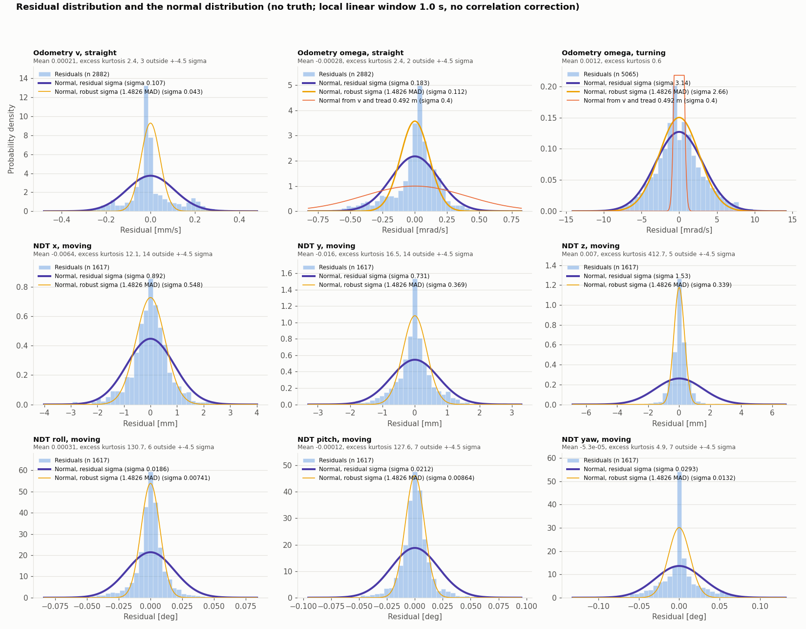
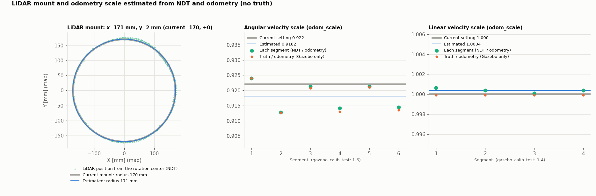
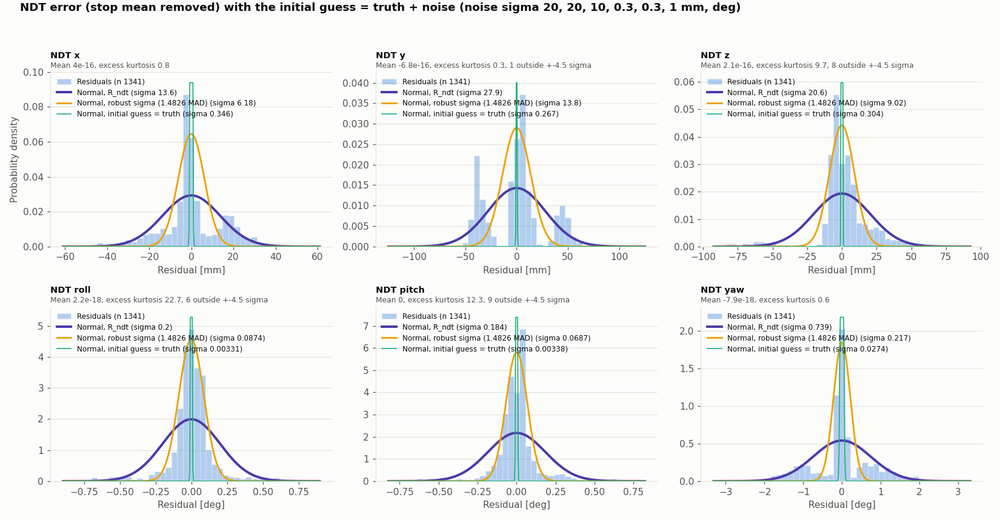
- 2026-10-15：ユーザー指示で直進を片道だけにした。
  - `param/calib.yaml` の `motion` は `stop_time`・`spin_omega`・`spin_turns`・`straight_v`・`straight_time` の 5 つ。
  - 直進は 0.4 m/s x 20 s = 8 m。往復をやめた分、15 s から延ばした。
  - Gazebo（`gazebo_calib_oneway`）：走行 98 s、run_calib.sh 全体で 2 分 48 秒（Gazebo の起動し直しと推定器の起動待ちを含む）。
  - 推定だけなら 8 s（252 s の録画）。走行時間ほどはかからない。
  - 結果は往復のときとほぼ同じ：
    - 倍率 omega 0.9193・v 1.0006。取付 x −170.5・y −2.1 mm、yaw −0.01°。
    - R_v 9.9e-9、R_omega 1.4e-7（直接測った omega の σ：直進 0.00018・旋回 0.0032 rad/s）。
    - roll・pitch は −0.14°・+0.06° で、往復のときの −0.03°・0.00° と違う。止まる場所が 2 か所だけで、その場所の床の傾きに左右される。参考値。

### 47. パラメータ推定を calibration/ にまとめ、NDT の R は止まる区間だけ流す

- 目的（ユーザー指示）：
  - 推定のファイルを drive と分け、`calibration/` にプログラムとパラメータを置く。推定の動きは 1 つで、推定専用のパラメータにする。
  - NDT の R（`ndt_init_noise.py`、約 9 分）は、止まっている区間だけを時間で区切って流す。安定してから 10 s ほどを使う。再生は速くしない。
  - 初期値のノイズは正規分布で、σ は 6 軸それぞれ 1 つ。パラメータで設定する。
- やったこと（localization_tools）：
  - `noise/`・`calib/`・`param/` を `calibration/` にまとめた。
  - 設定は `calibration/param/motion.yaml`（動き 6 つ）と `estimation.yaml`（推定）。
    - `estimation.yaml` は各プログラムのオプションの既定値で、`params.py` が読む。中身は区間の取り方・窓・Gazebo の車輪の間隔・ndt_init の
      `settle` 1 s・`use_time` 10 s・`lead` 1 s・`passes` 3・`sigma`。
    - `drive/config/gazebo.yaml` の `tread` は `estimation.yaml` に移した。
  - 動きは `calibration/motion.py` が作り、`drive/run_test.sh` に `PROFILES`（新しい環境変数）で渡す。drive の `profiles.yaml` からは外した。
    - 止まる時間を 12 s に延ばした。
    - 出発地点で 4 方向（90° ずつ）に止まる段を足した（`stop_headings`）。NDT の R に、いろいろな向きの止まる区間が要るため。
    - 順番：4 方向に止まる → 左右に 2 周ずつ → 止まる → 片道 8 m → 止まる。実機の上限で 171 s、Gazebo 177 s。計画はコマンド `calib_plan`。
  - `ndt_init_noise.py`：区間ごとに `ros2 bag play --start-offset` で、使う区間の 1 s 前から流す。区間の終わりの点群が届いたら止める。
    - Humble の `ros2 bag play` には終わりの時刻の指定が無いため、こうした。
  - `estimate_all.py`（Gazebo）は `ndt_init_noise.py` も行う。`--no-ndt-init` で省ける。
  - コマンド：`calib_params` は 2 つの設定を開く。`calib_plan <target>` を足した。
- 結果：
  - `stops_ekf`（13 か所 x 5 s。使えるのは各 4 s）の ndt_init は約 9 分 → 5 分 20 秒。σ はほぼ同じ
    （x・y・z 13.6・27.7・20.4 mm、roll・pitch・yaw 0.19・0.19・0.74°。全体を流したときは 13.6・27.9・20.6 mm、0.20・0.18・0.74°）。
  - Gazebo `gazebo_calib`（新しい動き）：
    - 推定は 309 s（ndt_init が 6 区間 x 10 s x 4 回、各回 609 スキャン）。
    - 倍率 omega 0.9196・v 1.0012。取付 x −171.2・y −2.0 mm、yaw −0.03°。R_v 1.2e-8 → R_omega 1.7e-7。
    - ndt_init の R_ndt の σ：x・y・z 13.6・27.5・24.4 mm、roll・pitch・yaw 0.21・0.23・0.72°（`stops_ekf` とほぼ同じ）。
      y の ±40 mm の別の山（近くの別の解）も同じように出た。

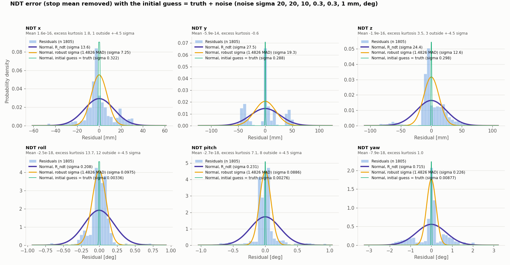
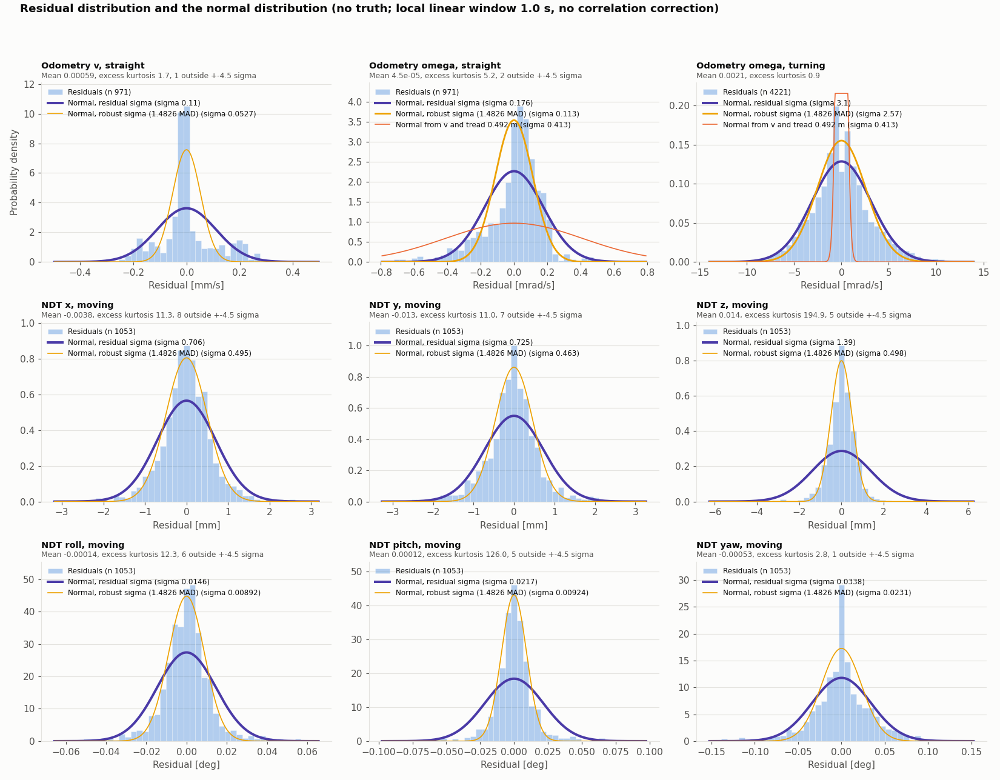
- 2026-10-15：ユーザー指示で、名前を calibration を基準にした。プログラム・変数・コマンドに estimate を入れない。
  - プログラム：
    - `estimate_all.py` → `calibrate.py`
    - `estimate_noise.py` → `calibrate_noise.py`
    - `ndt_init_noise.py` → `calibrate_ndt_noise.py`
    - `estimate_calibration.py` → `calibrate_mount_scale.py`（図は `plot_mount_scale.py`）
    - `run_calib.sh` → `run_calibration.sh`
  - 設定：`param/estimation.yaml` → `param/calibrate.yaml`（`ndt_init` の節 → `ndt_noise`）。
  - コマンド：
    - `calib` → `calibration`、`calib_estimate` → `calibrate`
    - `calib_plan` → `calibration_plan`、`calib_params` → `calibration_params`
  - 動き・出力：
    - 動きの名前と bag 名：`calibration`（`<target>_calibration_<日時>`）。
    - 結果：`fig/calibration/<bag>/` の `noise.*`・`mount_scale.*`・`ndt_noise.*`・`summary.yaml`（summary の取付は `calibrated`）。
  - 変数：`est`・`cal`・`est_odom` などを `settings`・`mount_scale`・`var_odom` などにした。
  - そのままにしたもの：前の録画（`gazebo_calib_test`・`gazebo_calib`）と開発ログの図の名前（`results/calib*.png`・`ndt_init_stops*`）。
    `results/calib_gazebo*/` の中は新しい出力の名前（`mount_scale.png`・`ndt_noise*.png`）にそろえた。
  - 確かめたこと：
    - コマンド `calibration_plan gazebo`、動きのファイルの受け渡し。
    - `calibrate gazebo gazebo_calib`（309 s。結果は前と同じ）。
    - `rerender_results.sh` のパラメータ推定の部分。

### 48. 推定用の動きを簡単にし、取付の yaw をオドメトリの平均で求める

- 目的（ユーザー指示）：
  - 動き：出発地点の 4 方向で止まる段は要らない（その場で 12 s 止まればよい）。旋回は左右 2 周ずつではなく、片方に 4 周。
  - 取付の yaw：少しまっすぐ進まないことを考える。オドメトリは振動するので、速度が安定してからの区間全体で v・omega を 1 つずつ求めて使う。
  - ヒストグラム：縦軸は全体を 1 とした棒ごとの割合にし、NDT の x, y, z と roll, pitch, yaw で縦軸をそろえる。
- やったこと：
  - 動き（`motion.yaml` は 5 つ）：止まる 12 s → その場で左に 4 周（0.4 rad/s）→ 止まる → 直進 0.4 m/s x 20 s → 止まる。
    実機の上限で 119 s。
  - `calibrate_mount_scale.py` の取付の yaw：
    - 直進の区間で、オドメトリの v が区間の後半の平均の 5 % 以内に入ってから（`calibrate.yaml` の `mount_scale.steady_tol`）、
      平均の v・omega（omega は推定した倍率を掛ける）を求める。
    - その一定の v・omega で動く円弧を、車体の位置に最小二乗で当てはめて、進む向きを出す。円弧の始点・向きと長さの倍率は線形で解ける。
    - 車体の位置は LiDAR の位置 − R(yaw_L) m'（m' は旋回で求めた取付。取付の yaw に左右されない）。
    - 取付の yaw は、LiDAR の yaw − 進む向きの平均。
    - 前の求め方（始点と終点を結ぶ向き）は比べるために出す。
  - `plot_hist`：
    - 縦軸は「その棒に入るサンプルの数 / 全体の数」（±4.5 σ を 45 本）。正規分布は棒の幅を掛けた割合。
    - NDT の 6 つの図は、縦軸の範囲を 6 つの中の最大にそろえる。
- 結果（Gazebo `gazebo_calibration`。走行と推定で 344 s。NDT の R は 3 区間 x 10 s x 4 回で、各回 307 スキャン）：
  - 倍率：omega 0.9230（左回りだけ）・v 1.0007。
  - 取付：x −171.6 mm、y −1.0 mm、yaw −0.010°（始点と終点を結ぶ向きでは −0.013°）。
    roll −0.12°・pitch 0.03° は、止まる場所が 2 か所だけなので参考値。
  - 前の録画で、取付の yaw を 2 つの求め方で比べた（直進中の NDT の yaw の変化 0.01〜0.19°）：
    - `gazebo_calib`：−0.020° と −0.026°。
    - `gazebo_calib_test`（4 区間）：−0.117・−0.016・−0.008・+0.019° と −0.102・−0.014・−0.003・+0.017°。
    - 真値は 0°。Gazebo はほぼまっすぐ進むので、差は 0.015° 以内だった。
  - R：R_v 1.2e-8 → R_omega 1.65e-7。NDT の R（真値 + ノイズ）の σ：x・y・z 13.2・27.1・25.6 mm、roll・pitch・yaw 0.19・0.25・0.70°
    （前の 6 区間とほぼ同じ）。

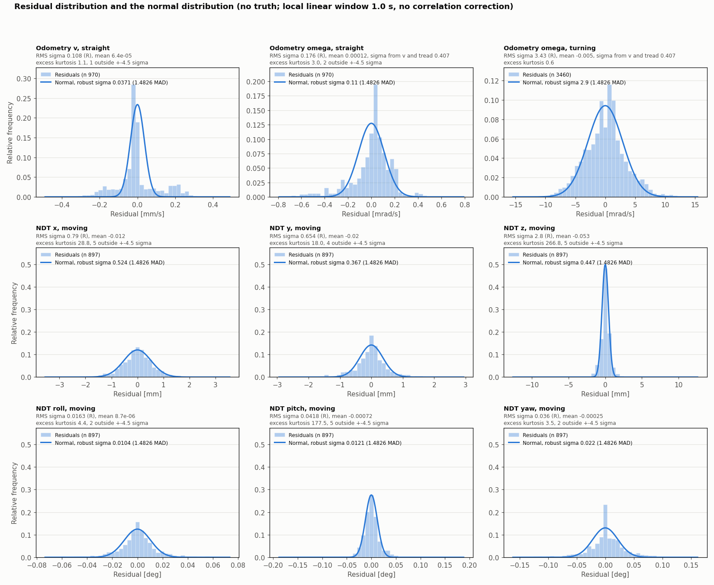
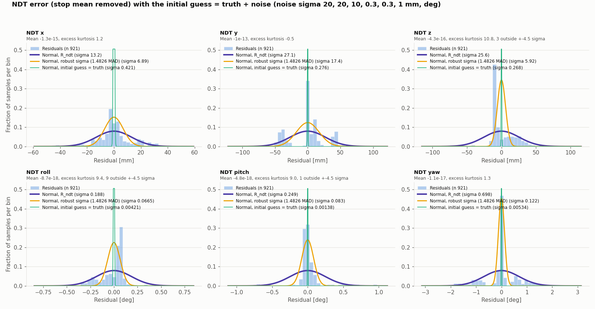

### 49. R_ndt を走行中の残差だけで求め、取付の yaw を各時刻で求める（Gazebo で LiDAR を 5° 回して試験）

- 目的（ユーザー指示）：
  - ヒストグラム：正規分布は外れ値に左右されない σ の線だけを青で描く。棒は黒で縁取る。縦軸のラベルは Relative frequency。
  - NDT の R は、走行中の NDT の位置が滑らかな動きからどれだけばらつくか、で求める（「真値 + ノイズ」の初期値の方法をやめる）。最初の停止もやめる。
  - 取付の yaw：NDT とオドメトリを平滑化して各時刻で求め、外れ値を除いて平均する。Gazebo で LiDAR をわざと 5° ずらして試す。
- やったこと：
  - `plot_hist`：正規分布は頑健な σ（1.4826 x 中央絶対偏差）の青の線 1 本。棒は黒で縁取る。縦軸は Relative frequency。
    残差の σ（R に使う値）と、v と車輪の間隔からの omega の σ は図の上の文字（2 行）にした。
  - `calibrate.py` から `calibrate_ndt_noise.py`（真値 + ノイズ）を外した（単独では使える）。R_ndt は `calibrate_noise.py` の走行中の残差
    （前後 0.5 s の局所 1 次式からのばらつき x 積分相関時間）。
  - 動き：その場で左に 4 周 → 止まる 5 s → 直進 0.4 m/s x 20 s → 止まる 5 s（実機の上限で 93 s）。
    最初の停止をやめ、止まる時間を 12 s から 5 s にした（12 s は真値 + ノイズの方法で 10 s 使うためだった）。
  - `calibrate_mount_scale.py`：取付の yaw の `pointwise`（既定）を足した。
    - オドメトリの v が安定してからの直進の区間で、車体の位置（LiDAR の位置 − 取付）と LiDAR の yaw を前後 0.5 s の局所 1 次式で平滑化する。
    - 各時刻の「LiDAR の yaw − 進む向き（位置の傾き）」を求める。オドメトリ（同じ窓で平滑化）の v が安定していない時刻は使わない。
    - 中央値から 3 x 1.4826 MAD より離れた値を除いて平均する。
    - 円弧の当てはめ（`arc`）と、始点と終点を結ぶ向き（`chord`）も並べて出す。図の右端に各時刻の値と外れ値を描く。
  - Gazebo（ユーザー指示。`gazebo_changes.md` の 3）：`wheelchair_2.xacro` の LiDAR の取付を、Gazebo に渡すモデルだけ yaw +5° にした。
    推定器が使う TF は 0° のままで、実機で取付がずれているのと同じ状態。試験のあと元に戻し、Gazebo を起動し直した。
    - 初めに試したセンサの `<pose>` の変更は効かなかった。Gazebo が固定の関節でつながったリンクを 1 つにまとめるとき、センサの pose を上書きするため。
- 結果：
  - LiDAR を 5° 回した Gazebo（`gazebo_calibration_yaw5`。走行 + 推定 161 s）での取付：
    - yaw：pointwise +5.002°（各時刻の sd 0.21°、187 点、外れ値 1）、arc +4.985°、chord +5.013°（真値 5.000°）。
    - x −170.5・y −1.9 mm（真値 −170・0）。
    - 取付が TF とずれていても NDT と推定器は動いた。ただし走行中の NDT の残差の σ は少し大きくなった
      （x 1.4・y 2.0 mm、ずらしていないとき 0.8・0.7 mm）。
  - ずらしていない録画での yaw（真値 0°）：

    | 録画 | pointwise | arc | chord |
    |---|---|---|---|
    | `gazebo_calibration` | −0.005° | −0.010° | −0.013° |
    | `gazebo_calib` | −0.016° | −0.020° | −0.026° |
    | `gazebo_calib_test`（4 区間） | −0.071〜+0.004° | −0.117〜+0.019° | −0.102〜+0.017° |

  - 各時刻の値は ±0.3° ほどゆっくり揺れ、外れ値はまとまって出る（1 点ずつ独立ではない）。そのため、各時刻の sd から平均のばらつきを出すと小さく見積もりすぎる。

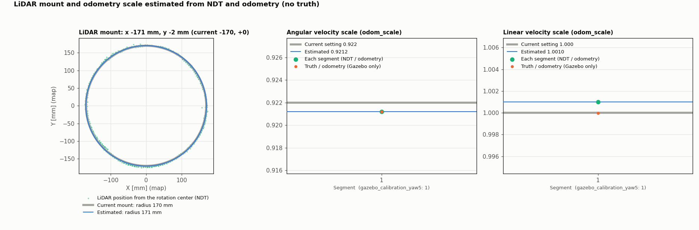

### 50. 取付と倍率を IEEE T-RO の方法（Censi ほか 2013）で検証し、yaw の図を足す

- 目的（ユーザー指示）：
  - 49 で挙げた IEEE Transactions on Robotics の方法で検証する。
  - 取付の yaw の時間推移と最終値の図を足す。
  - 図の枠を 4 辺とも黒にする（MATLAB の box on）。49 では棒の縁を黒にしていたが、指示は図の枠だった。
- 論文：A. Censi, A. Franchi, L. Marchionni, G. Oriolo, "Simultaneous Calibration of Odometry and Sensor Parameters for Mobile Robots,"
  IEEE Transactions on Robotics, vol. 29, no. 2, pp. 475–492, 2013（DOI 10.1109/TRO.2012.2226380）。
  - 実在を確かめた（Caltech・Sapienza の機関リポジトリ、IEEE Xplore）。
  - 本文は公開されていなかったので、式は著者の公開実装（github.com/AndreaCensi/calibration の `solver2_meat.cpp`・`calib_tuple.cpp`）で確かめた。
- やったこと：
  - `calibration/calibrate_joint.py`：
    - 区間（1 s）ごとに、左右の車輪の速度とセンサの動きを組にする。
      車輪の速度はオドメトリから戻した v ± omega b0/2、センサの動きは NDT の LiDAR の姿勢の差。
    - 1 段目：s_th = T (J21 u_L + J22 u_R) を線形の最小二乗で解く。
    - 2 段目：l ⊕ s = o ⊕ l から M = Σ L_kᵀ L_k を作り、x = [b, l_x, l_y, cos, sin] を cos² + sin² = 1 の制約付きで最小にする
      （b, l_x, l_y を消去した 2 x 2 の最小固有値。著者の実装のラグランジュ乗数の解と同じ）。
    - 残差の上位 1 % を除いて解き直す（4 回。著者の実装の既定）。ばらつきはブートストラップ 200 回。
    - 設定は `calibrate.yaml` の `joint`。`calibrate.py` が比べるために行い、`summary.yaml` の `joint_censi2013` に出す。
  - `calibrate_mount_scale.py`：取付と倍率の図（`mount_scale.png`）の右端の yaw は外し、別の図 `mount_scale_yaw.png` にした
    （各時刻の値・外れ値・最終値と、pointwise・arc・chord の値）。
  - 図の枠（`box_on`）：パラメータ推定の図はすべて 4 辺とも黒にした。ヒストグラムの棒の黒い縁はやめた。
- 結果（Gazebo。Censi の方法と今の方法の比較）：

  | 録画 | 方法 | omega の倍率 | v の倍率 | 取付 x [mm] | 取付 y [mm] | 取付 yaw [°] |
  |---|---|---|---|---|---|---|
  | `gazebo_calibration_yaw5`（真値 yaw 5°） | Censi | 0.9211 | 1.0009 | −170.6 ± 0.5 | −2.4 ± 0.8 | **+5.012 ± 0.071** |
  | | 今の方法 | 0.9212 | 1.0010 | −170.5 | −1.9 | **+5.002**（pointwise） |
  | `gazebo_calibration` | Censi | 0.9228 | 1.0008 | −171.4 | −1.6 | −0.011 ± 0.013 |
  | | 今の方法 | 0.9230 | 1.0007 | −171.6 | −1.0 | −0.005 |
  | `gazebo_calib` | Censi | 0.9197 | 1.0013 | −171.0 | −2.7 | −0.029 ± 0.038 |
  | | 今の方法 | 0.9196 | 1.0012 | −171.2 | −2.1 | −0.016 |
  | `gazebo_calib_test` | Censi | 0.9175 | 1.0010 | −171.3 | −3.9 | −0.026 ± 0.017 |
  | | 今の方法 | 0.9182 | 1.0004 | −170.6 | −2.4 | −0.020 |
  | `spin360_w1_ekf` + `ekf2` | Censi | 0.9236 | 0.9996 | −170.8 | −3.9 | +0.027 ± 0.005 |
  | | 今の方法 | 0.9233 | 0.9995 | −171.3 | −3.7 | +0.022 |

  - 2 つの方法の差は、倍率 0.002 以内、x・y 1.5 mm 以内、yaw 0.02° 以内だった。
  - Censi の方法の車輪の間隔 b は 0.533〜0.537 m（設定 0.492 m。回転中の滑りで実効的に広い。前に求めた 0.532〜0.535 m と同じ）。
    左右の車輪の倍率はほぼ同じ（差 0.0002 以内）。
  - Censi の方法は旋回と直進の全部の区間を 1 つの最小二乗で使い、ブートストラップでばらつき（yaw ± 0.01〜0.07°）も出る。

### 51. 取付の yaw を最小二乗の円弧の当てはめに決める

- 目的（ユーザー指示）：取付の yaw は元の方法のうち最小二乗を使うもの（円弧の当てはめ）に決め、論文の方法（Censi ほか 2013）は消す。
- やったこと：
  - `calibrate_mount_scale.py`：取付の yaw は円弧の当てはめだけにした。
    - オドメトリの v が安定してからの平均の v・omega で動く円弧を、車体の位置に最小二乗で当てはめる。
    - 各時刻の「LiDAR の yaw − 進む向き」を平均する。
    - 各時刻の方法（pointwise）と、始点と終点を結ぶ方法（chord）は消した（`calibrate.yaml` の `yaw_method`・`yaw_window`・`yaw_outlier_k` も）。
  - `calibrate_joint.py`（Censi ほか 2013）を消し、`calibrate.py` と `calibrate.yaml` の `joint` からも外した。比べた結果は 50 に残す。
  - `mount_scale_yaw.png`：各時刻の「LiDAR の yaw − 当てはめた円弧の進む向き」と最終値（平均）、今の設定（TF）。
- 結果（Gazebo）：
  - LiDAR を 5° 回した録画：+4.985°（各時刻のばらつきの sd 0.026°）。
  - ずらしていない録画：−0.010°（sd 0.026°）。

### 52. 取付の yaw を各時刻で求め、外れ値を RANSAC で除く

- 目的（ユーザー指示）：51 で決めたのは円弧の当てはめではなく、各時刻の方法（NDT とオドメトリを平滑化して各時刻で取付の yaw を出し、外れ値を除いて平均）だった。
  外れ値の除き方を RANSAC にする。
- やったこと（`calibrate_mount_scale.py`）：
  - 各時刻の値の出し方は 49 と同じ：車体の位置と LiDAR の yaw を前後 0.5 s で平滑化し、オドメトリの v が安定していない時刻は使わない。
  - RANSAC：
    - 各時刻の値を 1 つ選んで仮の値とし、0.3°（`ransac_threshold_deg`）以内のインライアを数える。200 回（`ransac_iterations`。乱数の種は固定）。
    - インライアが最も多いものを選び、その平均のまわりでインライアを選び直して平均（定数の最小二乗）する。
  - 円弧の当てはめは消した。
  - `mount_scale_yaw.png` は、インライア（緑）・外れ値（橙）・最終値（青）。
- 結果（Gazebo。閾値ごとの取付の yaw）：

  | 録画（真値） | 0.2° | 0.3°（既定） | 0.5° |
  |---|---|---|---|
  | `gazebo_calibration_yaw5`（5°） | +5.035°（外れ値 63 / 188） | +5.005°（26 / 188） | +5.002°（3 / 188） |
  | `gazebo_calibration`（0°） | −0.005° | −0.005° | −0.005° |
  | `gazebo_calib`（0°） | −0.011° | −0.033° | −0.019° |
  | `gazebo_calib_test`（0°、4 区間の平均） | −0.011° | −0.014° | −0.019° |

  - どの閾値でも真値との差は 0.04° 以内。0.2° では 5° の録画（取付が TF とずれていて各時刻のばらつきが大きい）の 3 分の 1 を捨てるので、0.3° にした。
  - 実機は各時刻のばらつきが Gazebo と違うかもしれないので、`mount_scale_yaw.png` を見て閾値を確かめる。

---

## 2026-10-19

### 53. RViz の点群を、その点群の NDT の解で表示する（`/aligned_points`）

- 目的（ユーザー指示）：RViz の `/velodyne_points` は、点群の stamp の時刻の TF map → velodyne で map に直される。
  この TF は ekf_localizer（`publish_trigger: cloud`）の**予測値**（1 つ前の NDT の事後推定値をオドメトリで点群の時刻まで進めたもの）で、
  その点群の NDT の解ではない。NDT の解（事後推定値）で、同じ時刻の点群を表示できるようにする。
- やったこと：
  - pcl_localization（lidar_localization）：位置合わせのあと、入力の点群をその点群の NDT の解（map → LiDAR）で map 座標に直して
    `/aligned_points` に出す（stamp は点群の取得時刻、frame は map。intensity・ring などのフィールドはそのまま）。
    パラメータ `publish_aligned_cloud`（既定 true）。購読者がいるときだけ変換する。fitness で EKF に渡さなかった解でも出す。
  - RViz（`localization2.rviz`）：`/aligned_points`（Aligned points (NDT)）を表示し、`/velodyne_points`（Points (EKF TF)）は既定で表示しない。
  - `plot/plot_prior_posterior.py`：録画の TF（予測値）と `/ndt_pose`（NDT の解）を同じ点群の stamp で比べる。
- 確かめたこと（実機 blue の録画 `blue_spin5_20261016_160557` を地図 `10build_4F_C_20260414.pcd` で再生。NDT の解は録画と平均 1.4 mm で一致）：
  - `/aligned_points` は、同じ stamp の `/velodyne_points` を同じ stamp の `/ndt_pose` で直したものと一致した（192 個を照合。差 0）。点数も同じ。
  - 届くのは点群の stamp から平均 79 ms（最大 170 ms）後（NDT の計算の分）。`/velodyne_points` の表示より遅れる。
  - RViz の画面ではまだ確かめていない。
- 結果（2 つの表示の差。NDT の解 − EKF の予測値、同じ点群の時刻）：

  | 録画 | 点群 | 水平の位置 平均 / 最大 | yaw 平均 / 最大 | 10 m 先の点のずれ 平均 / 最大 |
  |---|---|---|---|---|
  | `blue_spin5`（左右 5 周ずつ → 前進） | 1519 | 3.6 / 37 mm | 0.056 / 1.44° | 30 / 312 mm |
  | `blue_calibration`（推定用の動き） | 1365 | 2.3 / 50 mm | 0.046 / 1.38° | 30 / 260 mm |

  - 普段は 10 m 先で約 3 cm（roll・pitch の差も含む）。大きくずれるのは速度が変わる瞬間（回り始め・右回りへの切り替え・前進の始まり）で、
    予測が遅れるため（yaw 0.6〜1.4°、10 m 先で 0.1〜0.3 m）。

### 54. RViz の点群を、EKF の NDT の更新値で RViz 側が座標変換する（`/tf_ndt_update`）

- 目的（ユーザー指示）：53 の NDT の解で直した点群ではなく、EKF が NDT で状態を更新した直後の値（点群の時刻の事後推定値）を配信し、
  RViz 側で点群を座標変換する。
- やったこと：
  - ekf_localizer：`LaggedEkf::stateAfter(m)`（観測 m を適用した直後の状態。遅れて届いた NDT は点群の時刻まで巻き戻して入れるので、
    その時刻の事後推定値になる）を足した。NDT を入れるたびに、その値を TF map → base として `tf_ndt_update`（tf2_msgs/TFMessage、
    stamp は点群の取得時刻）に出す。パラメータ `publish_ndt_update_tf`（`ekf.yaml` は true、コードの既定は false）。
    `/tf` は今まで通り（`publish_trigger: cloud` なら点群の時刻の予測値。NDT の初期値に使うので変えない）。
    テスト `StateAfterIsPosteriorOfThatNdt`（`stateAfter` が、その NDT 以前の観測だけで順に求めた状態・`at(t)` と一致する）を足した。32 個すべて通る。
  - localization_bringup の launch：`use_ekf:=true` のとき RViz の `/tf` を `/tf_ndt_update` に付け替える
    （取付などの静的 TF は `/tf_static` のまま）。RViz の `/velodyne_points` は、点群の stamp の時刻の EKF の NDT の更新値で map に直される。
  - 53 の `/aligned_points` はやめた（lidar_localization の c3669f5 を戻した。RViz の設定も元に戻した）。
- 確かめたこと（`blue_spin5_20261016_160557` を再生。RViz の代わりに `/tf` を `/tf_ndt_update` に付け替えた TF の listener で、
  点群の stamp の map → velodyne が引けるか見た。RViz の画面ではまだ確かめていない）：
  - 受け取った点群 1117 個すべてで引けた。引けるのは点群の stamp から平均 0.13 s 後（95 % 0.25 s、最大 0.66 s）。
    RViz の表示は NDT の計算の分遅れる。
  - この再生はユーザーが同じコンテナで動かしていた Gazebo の自己位置推定と CPU を取り合い、NDT が解いたのは点群の 937 / 1114 個
    （元の録画では 1519 / 1527 個）。NDT が解かなかった点群の時刻の TF は、前後の更新値を補間したものになる。
- 結果（同じ点群の時刻。予測値は `/tf`、NDT の更新値は `/tf_ndt_update`（RViz が使う）、NDT の解は `/ndt_pose`）：

  | 差 | 水平の位置 平均 / 最大 | yaw 平均 / 最大 | 10 m 先の点のずれ 平均 / 95 % / 最大 |
  |---|---|---|---|
  | NDT の更新値 − 予測値 | 6.9 / 61 mm | 0.091 / 2.83° | 44 / 91 / 522 mm |
  | NDT の解 − NDT の更新値 | 0.2 / 1 mm | 0.000 / 0.00° | 2.2 / 5 / 12 mm |

  - blue の R_ndt（σ x 14 mm・yaw 0.20°）が小さいので、NDT の更新値は NDT の解とほぼ同じ（10 m 先の差は roll・pitch・z による）。
    R_ndt が大きいと、更新値は予測値と NDT の解の間になる。
  - 予測値との差は 53（元の録画、平均 30 mm・最大 312 mm）より大きい。この再生は CPU の取り合いで NDT が抜けていたため。

### 55. RViz の既定の視点を、自車両を中心に真上から（地図の向きで固定）にする・RViz の画面の録画

- 目的（ユーザー指示）：RViz の既定の視点を、自車両を中心に真上から見たものにする（画面の向きは地図で固定。ユーザーが選んだ）。
  RViz の画面を録画できるか確かめる。
- やったこと：
  - `localization2.rviz`（lidar_localization）の視点を `TopDownOrtho`（正射影）・Target Frame `base_link`・Scale 30 px/m にした。
    画面は回らず、車両の位置を追いかける（向きは地図のまま）。それまでは `ThirdPersonFollower`（斜め上、Target Frame `base_footprint`。
    実機には `base_footprint` が無い）。`base_link` は Gazebo（`base_footprint` → `base_link` の静的 TF）・実機の両方にある。
  - 録画：ホストは X11（`DISPLAY=:1`）なので、ホストの ffmpeg の `x11grab` で RViz の窓の範囲を録画した
    （コンテナの RViz はホストの X に描いている。コンテナには ffmpeg が無い）。録画は録画 bag の再生（`ROS_DOMAIN_ID=99`）中に行った。
- 結果：
  - `blue_spin5_20261016_160557` の再生で、視点が車両に付いて動き（赤い矢印 `/ekf_pose` が中心）、点群が地図の壁に重なることを確かめた（Global Status OK）。
  - 録画は 92 s・15 fps で 4.8 MB（`results/rviz_topdown_blue_spin5.mp4`）。窓が画面からはみ出している部分は録れない
    （x11grab は画面の範囲を録るので、はみ出す分は範囲を詰めた。重なった他の窓も写る）。

### 56. RViz の窓を探して録画するスクリプト（`record_rviz.sh`）

- 目的（ユーザー指示）：55 の手順（ホストの ffmpeg で RViz の窓を録る）を、窓を探すところからスクリプトにする。
- やったこと：localization_tools に `record_rviz.sh`（ホストで実行）を足した。
  - RViz の主窓（題名が「… - RViz」、幅 200 px 以上）を `xdotool` で探す。選び方は、自動（1 つならそれ、複数なら前面の窓）・
    `--new`（この後に開いた窓を待つ）・`--select`（クリック）・`--id`。`--list` で一覧を出す。
  - ffmpeg の x11grab の `-window_id` で窓の中身だけを録る。55 では画面の範囲を録ったので、窓が画面からはみ出すと録れず
    （範囲を詰めた）、他の窓も写った。`-window_id` なら窓に付いていく。
  - `-t` で時間、省くと Ctrl-C まで（Ctrl-C は ffmpeg が受けて書き終え、スクリプトは最後に長さを出す）。出力は断片化した MP4。
- 確かめたこと（ホスト。RViz は `blue_spin5_20261016_160557` の再生や Gazebo のコンテナのもの）：
  - `--list`、自動（窓が 2 つあると一覧を出して止まる）、`--id`、`-t`、Ctrl-C（プロセスグループに SIGINT。5.0 s の動画になった）。
  - `--new`：再生と一緒に開いた RViz を見つけて録り、再生が終わって RViz が閉じたところで止まった。それまでの 89.9 s は再生できる。
  - `--select`（クリック）はまだ試していない。

### 57. Gazebo の地面でオドメトリと真値の速度を比べる（その場の回転 0.5・1.0 rad/s、直進 0.5・1.0 m/s）

- 目的（ユーザー指示）：その場で 5 周の回転（0.5・1.0 rad/s）と 10 s の直進（0.5・1.0 m/s）で、オドメトリ（`/wheelchair/odom`）と
  真値（`/wheelchair/pose` の微分）の速度の時間推移を比べる。車椅子の初期位置は世界の原点・地面の 0.3 m 上（ユーザーが選んだ）。
- やったこと：
  - 初期位置は Gazebo の launch の引数 `x:=0 y:=0 z:=-0.4 yaw:=0` で渡した（Gazebo のファイルは変えていない）。原点は建物の外で、
    床は ground_plane（z −0.7 m、100 m 四方、障害物なし）。建物の 4 階の床は z 11.2 m より上。地図が無いので自己位置推定は起動しない。
  - localization_tools：設定 `drive/config/gazebo_ground.yaml`（上限 v 1.0 m/s・ω 1.0 rad/s で割合がそのまま m/s・rad/s。
    範囲の前を 15 m（この試験だけ。ユーザー指示）、`gazebo_launch_args`・`localization: false`）、動き `drive/profiles_velocity.yaml`
    （`spin5_w05`・`spin5_w10`・`straight_v05`・`straight_v10`。前後に止まる）、`run_test.sh` が設定の `gazebo_launch_args` を
    Gazebo の launch に渡し `localization: false` なら推定を起動しないようにした（`drive_test.py --get`）。図は `plot/plot_odom_truth.py`。
  - 録画は `bags/gazebo/gazebo_ground_{spin5_w05,spin5_w10,straight_v05,straight_v10}`。終わったあと Gazebo を元の初期位置
    （80, 7, 13、yaw 3.14）で起動し直した。
- 結果（動き出しの 2 s 後から止まる指令までの平均）：

  | 動き | 真値 | オドメトリ | 真値 / オドメトリ |
  |---|---|---|---|
  | 回転 0.5 rad/s | 0.448 rad/s（sd 0.005） | 0.493 rad/s（sd 0.011） | 0.907 |
  | 回転 1.0 rad/s | 0.900 rad/s（sd 0.005） | 0.998 rad/s（sd 0.007） | 0.901 |
  | 直進 0.5 m/s | 0.500 m/s（sd 0.002） | 0.500 m/s | 1.000 |
  | 直進 1.0 m/s | 1.000 m/s（sd 0.004） | 1.000 m/s | 1.000 |

  - 回転は真値がオドメトリより約 10 % 遅い（1 周 14.05 s・6.99 s）。建物の床で求めた倍率 0.922〜0.924（16）より小さい。
    床と地面で違う理由は調べていない。0.5 rad/s ではオドメトリが指令の 0.5 からときどき 0.47 前後に下がる（1.0 rad/s では少ない）。
  - 直進の v はオドメトリと真値が一致する。1.0 m/s の立ち上がりではオドメトリが真値より少し先に上がる（車輪の滑り。2026-10-11 に調べた前進の立ち上がりと同じ）。
    向きは 10 s の間に 0.5 m/s で −0.1°、1.0 m/s で −3.5° 変わった（drive_test.py のログ）。

- 図の凡例を `Truth (Avg. 0.448)`・`Odometry (Avg. 0.493)` のように平均（上の表の値）入りにし、図の中央の注記をやめた（2026-10-19、ユーザー指示。`plot_odom_truth.py`）。

### 57. 事後推定値で変換する RViz の画面の録画（blue spin）・rviz2_bag

- 目的（ユーザー指示）：54 の表示（点群を EKF の NDT の更新値 `/tf_ndt_update` で RViz が変換する）の画面を、blue の spin で録画する。
  左右の設定の欄（Displays・Views）は畳む。録画に rviz2_bag（https://github.com/shikishima-TasakiLab/rviz2_bag）を試す。
- rviz2_bag：RViz の中で bag を再生（Player）・記録（Recorder）するパネルで、画面を動画にする機能は無い（コンテナでビルドできることは確かめた）。
  ユーザーの判断で使わず、`record_rviz.sh`（56）で録画した。コンテナからは外した（ホストの `workspace/rviz2_bag` に clone が残る）。
- やったこと：`blue_spin5_20261016_160557` を地図 `10build_4F_C_20260414.pcd` で再生（`ROS_DOMAIN_ID=99`、launch は `rviz:=false`）し、
  RViz を別に `/tf:=/tf_ndt_update` で起動して `record_rviz.sh --new` で録った。
  - RViz の設定は録画用の写し（`localization2.rviz` から Displays・Selection・Tool Properties・Views のパネルを除いたもの）。
    `Hide Left Dock: true`・`Hide Right Dock: true` では、RViz2 は起動時に欄を畳まなかった。既定の `localization2.rviz` は変えていない。
  - rviz2 は SIGINT で終わらなかった（シグナルを受けたログは出るが窓が残る）ので、3 s 後に SIGKILL で止めた。
- 結果：91 s・15 fps・7.9 MB（`results/rviz_ndt_update_blue_spin5.mp4`）。視点は車両（赤い矢印 `/ekf_pose`）に付いて動き、点群は地図の壁に重なる。
  この再生では NDT の fitness の警告は 0 回、`No TF for init_guess` は 14 回（約 1500 個の点群のうち）。

## 2026-10-22

### 58. 環境ファイルの時刻の決め方を `clock_synced` から `stamp_mode`（stamp / receipt / auto）にする

- 目的（ユーザー指示）：`clock_synced: true / false / auto` は真偽値と文字列が混ざり、launch で `stamp / receipt / auto` に読み替えていて分かりにくい。
  ノード（`odom_covariance` の `stamp_mode`、`cloud_stamp_corrector` の `mode`）と同じ名前にする。`receipt` を `wall` にする案もあったが、
  受信したノードの時計（Gazebo では sim time）なので `receipt` のままにした（ユーザーが選んだ）。
- やったこと：localization_bringup：環境ファイル（red・blue・white・gazebo）を `stamp_mode: stamp` にし、launch は値をそのまま
  `odom_covariance` の `stamp_mode` と `cloud_stamp_corrector` の `mode` に入れる（`stamp` のときは `cloud_stamp_corrector` を起動しない。今までと同じ）。
  `clock_synced` が残っていれば、置き換え方（true → stamp、false → receipt、auto → auto）を書いたエラーで止める。README・`docs/node_graph.md`・
  `odom_covariance.py` の説明も直した。lidar_localization：`cloud_stamp_corrector.cpp` のコメントと README（コメントだけでコードは同じ）。
- 結果：コンテナ `test` で `ROS_DOMAIN_ID=99` で launch し、`gazebo`（stamp）は `cloud_stamp_corrector` なし・`odom_covariance` が `stamp_mode: stamp`、
  `stamp_mode: auto`・`receipt` に変えた写しはどちらも `cloud_stamp_corrector` の `mode` と `odom_covariance` の `stamp_mode` が同じ値で起動した。
  `clock_synced: true` と `stamp_mode: wall` は説明付きのエラーで止まった。

### 59. 起動するノードと、全ノードの購読・配信のトピックの名前を環境ファイルで選べるようにする

- 目的（ユーザー指示）：起動するノードを選べるようにし、購読・配信するトピックの名前を全部設定できるようにする。ノードの処理はできるだけ単純にする。
- 決めたこと（ユーザーが選んだ）：環境ファイルの `nodes.<ノード名>` に `enable` と `topics`（ノードの中の名前: 実際の名前）を書く（ノードごと）。
  launch は `topics` をそのまま remap に渡す（つながりごとの表は持たない）。全環境ファイルに全ノードの全トピックを書く。`/tf`・`/tf_static`・`/clock` は変えない。
  止めたノードの出力は録画や別の PC から来るものとして、つなぎ方は変えない。例外は今までと同じ 2 つ（EKF を起動しないと NDT が TF を出す、
  `cloud_stamp_corrector` を起動すると、ほかのノードで点群の入力をその出力に付け替える）。launch 引数 `use_ekf:=`・`rviz:=` は環境ファイルより優先（既定は空）。
- やったこと：localization_bringup：launch（`nodes` を読む。旧 `topics`・`launch_odometry`・`joint_state_odometry`、ノードの書き漏れ、知らないノード名、
  `cloud_stamp_corrector.enable` はエラー）、環境ファイル 4 つ（blue の R・Q などはそのまま）、README・`docs/node_graph.md`。ノードのコードは変えていない
  （ekf_localizer の `*_topic` と whill_odometry の `input_topic_name` は launch が中の名前に固定して remap する）。
  localization_tools：`calibrate.py` のオドメトリのトピックを `nodes.odom_covariance.topics.odom` から読む。`eval/batches` の 4 つから、
  今の `gazebo.yaml` と同じ値の `__env__.topics` を消した（`topics` は launch がエラーにするため）。
- 結果：コンテナ `test`（`ROS_DOMAIN_ID=99`）で、変える前と後の各ノードの購読・配信（`ros2 node info`）を比べ、`env:=gazebo`・`env:=gazebo use_ekf:=false`・
  `env:=red` の 3 つとも同じだった。`stamp_mode: auto` で `cloud_stamp_corrector` が起動し NDT・EKF が `/localization/points` を購読、
  `ndt_pose` などの名前を両側で変えるとつながったまま名前が変わる、`pcl_localization`・`whill_odometry` を止めるとその 2 つだけ起動しない、
  `joint_state_odometry` を起動すると `/wheelchair/joint_states` → `/localization/wheel_odom` になる、のを確かめた。RViz は起動せず、launch が作るノードの
  remap を読んで確かめた（EKF ありで `/tf` → `/tf_ndt_update`、`auto` で `/velodyne_points` → `/localization/points`、`rviz:=true` が環境ファイルより優先）。
  エラーの 7 通りも確かめた。
- 気づいたこと：RViz の設定（lidar_localization の `rviz/localization2.rviz`）の EKFPose は `/ekf/pose` を Pose（PoseStamped）で表示するが、
  配信するノードは無い（ekf_localizer は `/ekf_pose` を PoseWithCovarianceStamped で出す）。直していない。

### 60. ホストのフォルダを整理し、開発ログを GitHub で管理する

- 目的（ユーザー指示）：今後 localization 以外の Docker も使うので、ホストの `Docker/workspace` を `Docker/localization` にまとめる。開発ログなども GitHub で管理する。
- やったこと（2026-10-23）：
  - 構成：`Docker/localization/` に `src/`（開発中のリポジトリ 6 つと MATLAB）、`docker/`（localizer_docker と `data/`）、`results/`（図）、
    `archive/`（`localizer_ekf_docker`）を置いた。`localizer_docker-main`・`localizer_docker_test` はユーザーが消した。
  - `Docker/localization` を `MaeharaTakumi/localization_workspace`（Public）にした。管理するのは `CLAUDE.md`・`dev_log.md`・`gazebo_changes.md`・
    `dev_log_images/`・`repos.yaml`・`clone_repos.sh`・`README.md`。中のリポジトリ・`results/`・地図・動画は `.gitignore` で外した（ユーザー指示）。
  - 開発ログに埋め込む図は `dev_log_images/`（61 枚、12 MB）に写し、埋め込みのパスを書き換えた（ユーザーの案）。
  - localization_tools の `sync.sh pull` の図の行き先を `Docker/localization/results` にした（`42ec148`）。
  - コンテナ `test` を作り直した。録画・地図・図の割り当てが古いパスのままだったため（`docker compose up -d --no-build --force-recreate`）。
    - 作り直す前に、コンテナの中の `src` がホストと同じこと（違いは localization_bringup の説明文 2 つだけで、ホストが新しい）を確かめた。
    - 作り直したあと、`src/` の 4 つを写してビルドし、localization_tools を写した（イメージを作ったときの古い `calib/`・`noise/` は消した）。
      `.bash_history`・`.rviz2` を戻した。
    - `.bashrc`・`fastdds_localhost.xml`・`.bash_aliases` は前と同じだった。
- 確かめたこと：
  - 新しい場所の録画・地図が見える。ekf_localizer のテスト 32 個が通った。
  - ROS 2 のソケットは 127.0.0.1 だけで、TCP なし、239.255.0.1 に参加しない。
  - Gazebo を起動するとオドメトリが届いた（確かめたあと Gazebo は止めた）。

## 2026-10-23

### 61. MATLAB 用に、予測した base の姿勢（50 Hz）と、NDT で更新した直後の LiDAR の姿勢・同じ時刻の点群を出す

- 目的（ユーザー指示）：MATLAB で、後輪の間の中心の姿勢 base_pose を予測で 50 Hz、LiDAR の姿勢 vlp16_pose を NDT で更新した値で購読し、
  点群と同じ時刻の姿勢を組にして使う。今の MATLAB（`CR_debug` の `SensorFetcher`）は `/velodyne_points` と `/ekf_pose` をそれぞれ最新で取っていて、
  時刻がそろう保証がない（Gazebo の `/ekf_pose` は最新のオドメトリの時刻、実機の `/ekf_pose` は点群の時刻の予測値）。
- 決めたこと（ユーザーが選んだ）：型は PoseWithCovarianceStamped、トピックは `/localization/` の下。vlp16_pose は NDT が遅れたときに
  予測値で代わりに出すことはしない（一番単純な方法。NDT が遅れても base_pose は 50 Hz で届く）。点群の出し直しは ekf_localizer に入れる
  （やりやすい方）。録画に base_pose・vlp16_pose を足し、vlp16_points は足さない（中身は `/velodyne_points` と同じ）。
- 先に測ったこと（録画の受信時刻と stamp）：実機 blue の走行中（`blue_spin5`）は、点群が stamp から 15 ms 後に届き、NDT の解は点群が届いてから
  平均 34 ms（95 % 41、最大 122 ms。30 ms 以内は 15 %、50 ms 以内は 99.4 %）。Gazebo（`gazebo_spin5`・`gazebo_slalom`）は平均 37〜43 ms
  （50 ms 以内は 92〜96 %）。53 の「点群の stamp から平均 79 ms」は再生のときの値で、走行中は平均 49 ms。
- やったこと：
  - ekf_localizer：出力を 3 つ足した（どれも `/tf`・`/ekf_pose` の出し方（NDT の初期値）と推定の計算は変えない）。
    - `base_pose`（`base_pose_rate` [Hz]、`ekf.yaml` は 50、コードの既定 0 = 出さない）：`publish_trigger` とは別のタイマーで、最新の状態を
      現在時刻まで予測した map → base と base の 6x6 の共分散（`timer` と同じ計算）。reliable、KeepLast(1)。
    - `vlp16_pose`（`publish_vlp16_pose`）：NDT を入れた直後の状態（`stateAfter`、`/tf_ndt_update` と同じ）の map → LiDAR と J P Jᵀ。
      stamp は点群の取得時刻。reliable、KeepLast(10)。
    - `vlp16_points`（`publish_vlp16_points`）：届いた点群を stamp ごとに `history_length`（1 s）まで持っておき、`vlp16_pose` の直後に
      同じ stamp の点群をそのまま出す。それ以前の点群（NDT が解かなかったもの）は捨てる。reliable、KeepLast(2)。
    - `/ekf_pose`・`/ekf_odom` を作る処理を `lidarPoseMsg`・`basePoseMsg` にまとめた（値は同じ）。README・`docs/ekf_flow.md`。
  - localization_bringup：環境ファイル 4 つの `nodes.ekf_localizer.topics` に `/localization/base_pose`・`vlp16_pose`・`vlp16_points`、`docs/node_graph.md`。
  - localization_tools：`drive/config`（red・blue・white・gazebo・real_in_gazebo）の録画に `/localization/base_pose`・`/localization/vlp16_pose`。
    `eval/replay_outputs.py`（録画全体を `ROS_DOMAIN_ID=99` で再生して出力を録る。実機の録画は環境ファイルの写しを `use_sim_time: true` にして `--clock` で流す）、
    `plot/plot_matlab_outputs.py`（下の確かめと図）。
- 結果：ekf_localizer のテスト 32 個が通った。録画を再生して確かめた（`plot_matlab_outputs.py`）：

  | | Gazebo `gazebo_spin5` | 実機 blue `blue_spin5` |
  |---|---|---|
  | base_pose | 50.0 Hz（間隔 20 ms、最大 30 ms）。stamp から受信まで平均 0.4 ms | 50.0 Hz（最大 35 ms）。平均 0.3 ms |
  | vlp16_pose | 1040 個（`/ndt_pose` と同じ数・同じ stamp）。`/tf_ndt_update` × 取付と一致（差 0）。点群の stamp から受信まで平均 40 ms（95 % 51 ms） | 730 個（同上）。一致。平均 70 ms（再生のため） |
  | vlp16_points | 1040 個。すべてに同じ stamp の vlp16_pose があり、中身は入力の点群と同じ | 499 個。すべてに同じ stamp の vlp16_pose があり、中身は同じ。点群の付かない vlp16_pose が 231 個（ekf_localizer が受け取れなかった点群） |
  | 点群の時刻の base_pose − NDT で更新した直後の値 | 水平 平均 1.0 mm（95 % 1.9、最大 37 mm）、yaw 平均 0.1°（最大 2.8°） | 平均 10.5 mm（95 % 20 mm）。最大 0.9 m・25° は再生で点群が落ちたため |

  - 録画するノードには、姿勢より点群のほうが先に届いたものがある（Gazebo で 1040 個中 259 個、最大 18 ms 先）。購読する側は、2 つの stamp が
    同じときだけ組にし、違えば前回の組を使う。
  - 実機の録画をコンテナの中で再生すると、大きい点群（1 個 0.3 MB）が受け取る側で落ち、NDT が解いたのは 1527 個中 730 個だった。
    新しい出力を止めても同じ（NDT 692 個、予測値と NDT で更新した直後の値の差は最大 2.2 m・26°。`tune/vlp16_check_blue_spin5_off`）で、
    0.5 倍の速さで流しても変わらなかったので、今回の変更によるものではない（走行中の録画では NDT は 1519 個を解いていた）。
  - base_pose は、NDT が届いてその時刻まで巻き戻して入れた直後に、点群の時刻の予測値と更新値の差（上の表）だけ跳ねる。
- まだのこと：MATLAB（`CR_debug`）は変えていない（購読するトピック・`vehicleInfo.sensor` の欄・`Plant` の意味が変わるので、変え方をユーザーに聞く）。

